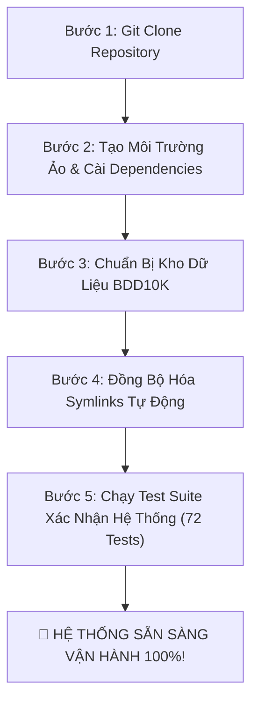

# 🚀 HƯỚNG DẪN BẮT ĐẦU DỰ ÁN CHO NGƯỜI MỚI (GETTING STARTED & ONBOARDING GUIDE)
*(Dành cho Kỹ sư MLOps, Data Scientist và Nhà nghiên cứu khi Clone/Git Pull repo về máy)*

> [!NOTE]
> Cẩm nang này hướng dẫn chi tiết từng bước từ khi bạn gõ lệnh `git clone` hoặc `git pull` trên máy cá nhân cho đến khi kích hoạt thành công toàn bộ hệ thống thực nghiệm Active Learning.

---

## 📋 1. Yêu Cầu Môi Trường & Phần Cứng (Prerequisites)

### 1.1. Hệ Điều Hành Hỗ Trợ
- **macOS**: Hỗ trợ xuất sắc chip Apple Silicon (M1/M2/M3/M4) qua cơ chế tăng tốc phần cứng `mps` (Metal Performance Shaders).
- **Linux (Ubuntu 20.04 / 22.04 LTS)**: Hỗ trợ tối ưu cho GPU NVIDIA (CUDA 11.8 / 12.x).
- **Windows**: Khuyến nghị sử dụng **WSL2 (Windows Subsystem for Linux)** để đảm bảo tính tương thích của hệ thống tệp và liên kết symbolic links.

### 1.2. Phần Mềm Yêu Cầu
- **Python**: Phiên bản `3.10` hoặc `3.11` (khuyến nghị `3.11`).
- **Git**: Đã cài đặt Git trên máy.

---

## ⚡ 2. Quy Trình 5 Bước Thiết Lập Toàn Bộ Dự Án (5-Step Setup)



---

### Bước 1: Clone Repository Về Máy
Mở terminal và thực hiện clone repo về thư mục làm việc của bạn:

```bash
git clone https://github.com/nguyenhuynhdt37/bdd10k-active-learning-ai.git
cd bdd10k-active-learning-ai
```

*(Nếu bạn đã clone trước đó, chỉ cần cập nhật code mới nhất):*
```bash
git pull origin main
```

---

### Bước 2: Khởi Tạo Môi Trường Ảo & Cài Đặt Thư Viện

Nên sử dụng môi trường ảo độc lập để tránh xung đột thư viện hệ thống:

```bash
# 1. Khởi tạo virtual environment
python3 -m venv .venv

# 2. Kích hoạt môi trường ảo
# Trên macOS / Linux:
source .venv/bin/activate

# Trên Windows (Git Bash / PowerShell):
# source .venv/Scripts/activate

# 3. Cập nhật pip và cài đặt toàn bộ dependencies
pip install --upgrade pip
pip install -r requirements.txt
```

*(Tùy chọn cho triển khai cạnh biên)*: Nếu bạn muốn chạy xuất xưởng ONNX và OpenVINO INT8, hãy cài thêm:
```bash
pip install onnx onnxruntime openvino
```

---

### Bước 3: Chuẩn Bị Dữ Liệu Nguồn BDD10K

> [!IMPORTANT]
> **Quy Tắc Read-Only Bất Biến**: Repo mã nguồn trên Git tuân thủ nguyên tắc bảo vệ tài nguyên nên **không commit 767MB ảnh nhị phân**. Toàn bộ cấu trúc thư mục rỗng đã được giữ sẵn bằng các file `.gitkeep`.

Bạn cần nạp tập dữ liệu chuẩn BDD10K vào thư mục [`data/bdd10k/`](data/bdd10k/) theo cấu trúc chuẩn:

```text
data/bdd10k/
├── bdd10k_metadata.json          # File metadata nhãn gốc (36.3 MB)
├── bdd10k.yaml                   # Cấu hình danh mục 10 lớp
├── README.md
├── images/
│   ├── train/                    # 7.000 ảnh JPEG huấn luyện gốc
│   ├── val/                      # 1.000 ảnh JPEG kiểm định gốc
│   └── test/                     # 2.000 ảnh JPEG kiểm thử gốc
└── labels/
    ├── train/                    # 7.000 file nhãn YOLO (.txt)
    └── val/                      # 1.000 file nhãn YOLO (.txt)
```

**Mẹo tiết kiệm dung lượng (Dùng Symlink nếu bạn đã tải BDD10K ở ổ đĩa khác)**:
Nếu bạn đã có thư mục BDD10K ở vị trí khác trên máy (ví dụ `/data/datasets/bdd10k`), bạn không cần sao chép tốn dung lượng, chỉ cần tạo symlink:
```bash
# Liên kết thư mục images
rm -rf data/bdd10k/images
ln -s /duong/dan/toi/bdd10k/images data/bdd10k/images

# Liên kết file metadata json
ln -s /duong/dan/toi/bdd10k/bdd10k_metadata.json data/bdd10k/bdd10k_metadata.json
```

---

### Bước 4: Đồng Bộ Hóa Cấu Trúc Dữ Liệu Cục Bộ (Tái Tạo Symlinks)

Do cơ chế **Zero-Copy Symlink** tối ưu dung lượng đĩa = 0 KB, các tập splits được quản lý qua liên kết biểu tượng. Khi vừa clone về máy mới, bạn chỉ cần chạy đúng 1 lệnh để tự động tạo toàn bộ splits phù hợp với đường dẫn tuyệt đối trên máy của bạn:

```bash
PYTHONPATH=. .venv/bin/python scripts/run_phase_03_frozen_splits.py
```

Lệnh này sẽ tự động:
1. Đọc metadata BDD10K.
2. Áp dụng thuật toán Quán quân **Hybrid Mix 80/20 & Group-Aware Video Isolation**.
3. Tạo 100% symlinks hợp lệ cho:
   - `data/splits/fixed_test/` (1.400 ảnh - Frozen Gold Test).
   - `data/splits/fixed_val/` (700 ảnh - Fixed Validation).
   - `data/splits/seed_v0/` (500 ảnh - Seed Training).
   - `data/splits/unlabeled_pool/` (4.394 ảnh - Mining Pool).

---

### Bước 5: Kiểm Toán Tính Sẵn Sàng (Run Verification Test Suite)

Chạy bộ kiểm thử tự động toàn diện gồm **72 Unit Tests**:

```bash
PYTHONPATH=. .venv/bin/pytest tests/
```

**Kết quả mong đợi:**
```text
============================= 72 passed in 21.xxs ==============================
```
Khi thấy dòng thông báo trên, xin chúc mừng! Máy tính của bạn đã được cấu hình hoàn hảo 100% và sẵn sàng cho mọi tác vụ nghiên cứu hay vận hành.

---

## 🎯 3. Cẩm Nang Thực Hiện Theo Từng Nhu Cầu Cụ Thể

### 3.1. Dành Cho Nhà Nghiên Cứu (Khám Phá & Trực Quan Hóa Tương Tác)
Bạn muốn quan sát từng bước thí nghiệm qua giao diện trực quan:
1. Khởi chạy Jupyter Lab / Notebook:
   ```bash
   jupyter notebook
   ```
2. Mở chuỗi Notebooks theo thứ tự trong thư mục [`notebooks/`](notebooks/):
   - `01_dual_stream_fastdedup_benchmark.ipynb`: Đối chuẩn 6 giải thuật lọc trùng.
   - `02_automated_data_profiling_benchmark.ipynb`: Trích xuất 11 thuộc tính vật lý.
   - `03_shared_frozen_test_val_splits.ipynb`: Phân lập 4 tập dữ liệu cách ly video.
   - `04_seed_v0_training_ablation.ipynb`: Huấn luyện mô hình mầm V0 (YOLO11n vs RT-DETR).
   - `05_active_mining_tournament_and_hitl.ipynb`: Đấu trường chọn mẫu C6 Super-Fusion.
   - `06_model_v1_retraining_and_gold_benchmark.ipynb`: Tái huấn luyện Model V1.
   - `autonomous_pipeline_loop/07_end_to_end_autonomous_active_loop.ipynb`: Vòng lặp tự trị toàn trình.

---

### 3.2. Dành Cho Kỹ Sư MLOps (Chạy Tự Động Hóa Bằng Dòng Lệnh CLI)

- **Chạy kiểm toán ngẫu nhiên 100 ảnh đối chuẩn chất lượng:**
  ```bash
  .venv/bin/python scripts/audit_random_100_images.py
  ```

- **Kích hoạt Vòng Lặp Active Learning Tự Động Toàn Trình:**
  ```bash
  PYTHONPATH=. .venv/bin/python scripts/run_phase_07_autonomous_loop.py
  ```
  Hệ thống sẽ tự động chạy qua các vòng lặp (Iterations 1 ➔ 5), tính toán vector thâm hụt lớp động $C_w$, khai thác mẫu khó, huấn luyện tiếp sức và tự động dừng khi thỏa mãn rào chắn chiến thắng `VICTORY_CONFIRMED`.

---

### 3.3. Dành Cho Kỹ Sư Nhúng / Cạnh Biên (Edge Deployment)

- **Xuất xưởng mô hình sang ONNX & OpenVINO INT8:**
  ```python
  from ultralytics import YOLO

  # Nạp checkpoint tốt nhất đã huấn luyện
  model = YOLO("models/yolo11n_v1_best.pt")

  # 1. Export sang ONNX FP16
  model.export(format="onnx", half=True, dynamic=True)

  # 2. Export sang OpenVINO INT8 siêu nhẹ (<8ms trên CPU nhúng)
  model.export(format="openvino", int8=True, data="data/splits/bdd10k_splits_v1.yaml")
  ```

---

## 🛠️ 4. Xử Lý Các Sự Cố Thường Gặp Khi Mới Clone Về (FAQ)

### ❓ Lỗi 1: `ModuleNotFoundError: No module named 'src'`
- **Nguyên nhân**: Python chưa nhận diện được thư mục gốc dự án trong biến môi trường `PYTHONPATH`.
- **Cách khắc phục**:
  - Khi chạy script từ terminal, luôn thêm tiền tố: `PYTHONPATH=. python scripts/...`
  - Hoặc thiết lập cố định cho phiên làm việc hiện tại:
    ```bash
    export PYTHONPATH=.
    ```

### ❓ Lỗi 2: `AssertionError: Có X broken symlinks` khi chạy test
- **Nguyên nhân**: Bạn vừa clone repo sang một máy tính mới có đường dẫn thư mục gốc khác với máy của tác giả.
- **Cách khắc phục**:
  Chạy lệnh đồng bộ hóa splits tại Bước 4:
  ```bash
  PYTHONPATH=. .venv/bin/python scripts/run_phase_03_frozen_splits.py
  ```
  Toàn bộ symlinks sẽ được liên kết lại chuẩn xác theo đường dẫn tuyệt đối của máy tính hiện tại.

### ❓ Lỗi 3: `CUDA out of memory` hoặc máy không có GPU rời
- **Nguyên nhân**: Cấu hình batch size mặc định quá lớn so với VRAM card đồ họa của bạn.
- **Cách khắc phục**:
  Hệ thống được thiết kế tương thích hoàn hảo với CPU và Apple Silicon MPS. Trong các script huấn luyện (`scripts/run_phase_04_...`), bạn có thể hạ tham số `batch=8` hoặc `batch=4` và đặt `device='cpu'` hoặc `device='mps'`.

---

## 📖 5. Điều Hướng Tài Liệu Chuyên Sâu

Để hiểu sâu hơn về kiến trúc và toán học bên dưới nắp capô của hệ thống, hãy tham khảo các tài liệu chuyên ngành trong thư mục [`docs/`](docs/):
- 📘 [Kiến Trúc Toàn Trình A-Z](docs/02_SYSTEM_ARCHITECTURE_AND_DATA_FLOW.md)
- 📗 [Bóc Tách Kỹ Thuật Chi Tiết 7 Phases](docs/03_DEEP_TECHNICAL_DESIGN_PHASES_01_TO_07.md)
- 📙 [Cẩm Nang Vận Hành Production Chi Tiết](docs/04_PRODUCTION_RUNBOOK_AND_OPERATIONS.md)
- 📕 [Triển Khai Cạnh Biên & Streaming HITL](docs/05_EDGE_DEPLOYMENT_AND_STREAMING_HITL.md)
- 📊 [Bảng Số Liệu Đối Chuẩn Khoa Học 10 Lớp](docs/06_BENCHMARKS_AND_EXPERIMENTAL_RESULTS.md)
