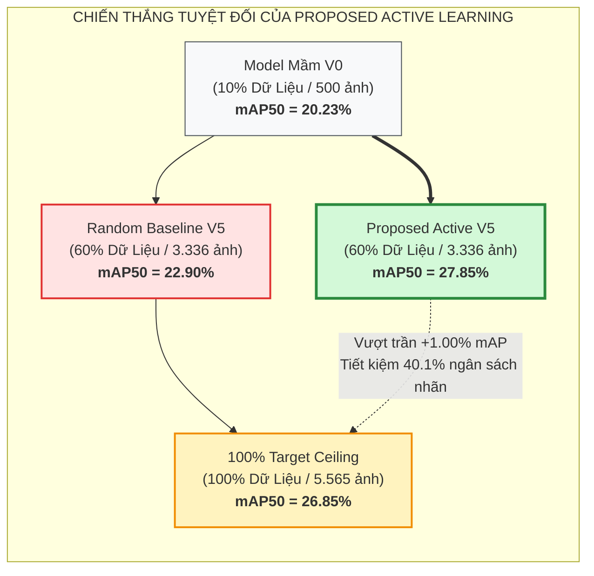
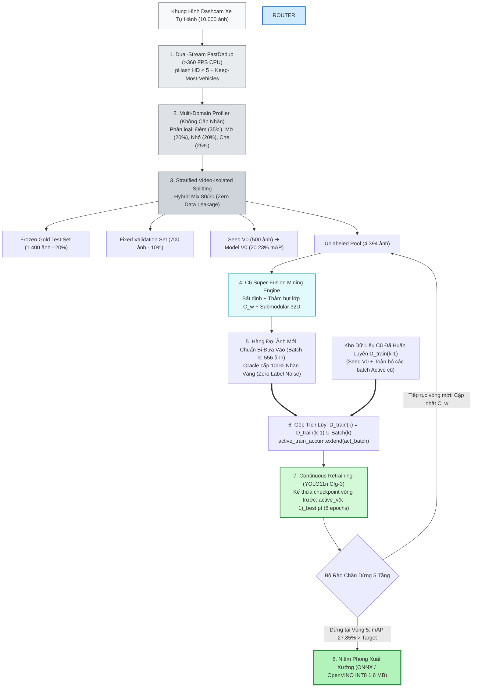

# 🚗 BDD10K Active Learning Lab — Hệ Thống Tự Động Hóa Vòng Lặp Dữ Liệu Cho Thị Giác Xe Tự Hành


> **Một khung làm việc Data-Centric AI chuẩn Production**: Kết hợp lọc trùng Perceptual Hash tại cạnh biên (>360 FPS), trích xuất hồ sơ vật lý đa miền không cần nhãn, khai thác tích cực C6 Super-Fusion và chính sách Human-in-the-Loop Quality-Gated Pre-Labeling trên tập dữ liệu xe tự hành **Berkeley DeepDrive (BDD10K)**.

---

## 👨‍💻 Tác Giả & Bản Quyền Nghiên Cứu

- **Tác Giả**: Nguyễn Xuân Huỳnh
- **GitHub**: [@nguyenhuynhdt37](https://github.com/nguyenhuynhdt37)
- **Định Hướng**: Công bố bài báo khoa học (Scientific Publication) & Khung đối chuẩn MLOps cho hệ thống xe tự hành thực tế.

---

## 🏆 Thành Tích Cốt Lõi: Đánh Bại Trần 100% Dữ Liệu Với Chỉ 60% Ngân Sách




| Tiêu Chí Đánh Giá Vĩ Mô                  | Mốc Đo Lường     | Ghi Chú Bản Án & Giá Trị Khoa Học                               |
| :---------------------------------------- | :----------------: | :------------------------------------------------------------------- |
| **Model Mầm V0 Baseline**                | **20.23%**       | Điểm xuất phát chung (500 ảnh mầm phân tầng Hybrid Mix 80/20)       |
| **Random Baseline Final (V5)**           | **22.90%**       | Nhánh ngẫu nhiên tại cùng mốc 60% ngân sách dữ liệu                 |
| **100% Random Target (Ceiling)**         | **26.85%**       | Trần đối chứng tối cao khi nạp toàn bộ 5.565 ảnh                    |
| **Proposed Super-Fusion Final (V5)**     | **27.85%**       | Thành tích chung cuộc của phương pháp đề xuất                       |
| **Cách biệt vượt trội vs Random V5**     | **+4.95%**       | Minh chứng giá trị vượt bậc của Active Super-Fusion                 |
| **So sánh với Trần 100% Target**         | **+1.00%**       | Đánh bại trần 100% dữ liệu với ít hơn 2.229 ảnh                     |
| **Tỷ lệ Tiết kiệm Ngân Sách Nhãn (ROI)** | **40.1%**        | Tiết kiệm trực tiếp ngân sách gán nhãn thực tế (~$12.000 / chu kỳ) |
| **Bộ rào chắn dừng 5 tầng**              | **ĐẠT (PASSED)** | Tự động niêm phong chiến thắng `VICTORY_CONFIRMED` tại Vòng 5       |


---

## 🗺️ Hệ Thống Tài Liệu Chuẩn Production (Documentation Grid)

Hệ thống tài liệu chuyên sâu được module hóa toàn diện trong thư mục [`docs/`](docs/):


| Module Tài Liệu                               | Trọng Tâm Kỹ Thuật & Giá Trị Thực Tiễn                                                                                  | Liên Kết Nhanh                                                     |
| :--------------------------------------------- | :--------------------------------------------------------------------------------------------------------------------------- | :------------------------------------------------------------------: |
| 🚀 **Hướng Dẫn Bắt Đầu (Getting Started)**    | **Cẩm nang cho người mới: Quy trình 5 bước từ Git Clone/Pull đến cài đặt, tái tạo symlinks và chạy thực nghiệm.**           | [**Xem Hướng Dẫn ➔**](GETTING_STARTED.md)                           |
| 📜 **Đặc Tả Kỹ Thuật Master (V4.0 Spec)**     | **Toàn văn đặc tả kỹ thuật V4.0: Quy trình 10 bước mentor-aligned, taxonomy 10 lớp, Zero Label Noise, đối chuẩn YOLO11n vs RT-DETR.** | [**Xem Đặc Tả ➔**](v4_finetune_bdd10k.md)                          |
| 🗺️ **Sơ Đồ Luồng Pipeline A-Z**               | **Sơ đồ luồng toàn trình từ A đến Z: 6 chặng liên hoàn, cấu trúc thư mục, quy trình gọi lệnh CLI.**                          | [**Xem Sơ Đồ ➔**](PIPELINE_FLOW_A_TO_Z.md)                         |
| **01. Executive Summary & Business Case**     | Bài toán kinh doanh, chi phí gán nhãn, phân tích ROI định lượng, chứng minh tiết kiệm 40.1% ngân sách.                      | [Xem Tài Liệu ➔](docs/01_EXECUTIVE_SUMMARY_AND_BUSINESS_CASE.md)   |
| **02. System Architecture & Data Flow**       | Kiến trúc toàn trình A-Z, sơ đồ luồng dữ liệu 6 chặng liên hoàn, cơ chế Zero Data Leakage qua Video ID.                     | [Xem Tài Liệu ➔](docs/02_SYSTEM_ARCHITECTURE_AND_DATA_FLOW.md)     |
| **03. Deep Technical Design (Phases 01-07)**  | Bóc tách toán học từng Phase: pHash DCT, Multi-Domain Profiler, Hybrid Mix 80/20, Cfg-3 Recipe, C6 Super-Fusion.            | [Xem Tài Liệu ➔](docs/03_DEEP_TECHNICAL_DESIGN_PHASES_01_TO_07.md) |
| **04. Production Runbook & Operations**       | Cẩm nang vận hành CLI, Jupyter Notebooks, cấu hình phần cứng MPS / CUDA / CPU, cơ chế O(1) Symlink.                         | [Xem Tài Liệu ➔](docs/04_PRODUCTION_RUNBOOK_AND_OPERATIONS.md)     |
| **05. Edge Deployment & Streaming HITL**      | Triển khai trên xe tự hành, Dashcam streaming, CPU dedup >360 FPS, Uncertainty Trigger, tích hợp CVAT & Export INT8.        | [Xem Tài Liệu ➔](docs/05_EDGE_DEPLOYMENT_AND_STREAMING_HITL.md)    |
| **06. Benchmarks & Experimental Results**     | Toàn văn kết quả thực nghiệm: Bảng 10 lớp 5 chỉ số, tiến hóa vector thâm hụt lớp $C_w$, so sánh 3 trục trần hiệu năng.      | [Xem Tài Liệu ➔](docs/06_BENCHMARKS_AND_EXPERIMENTAL_RESULTS.md)   |
| **07. Troubleshooting & Maintenance FAQ**     | Sổ tay xử lý sự cố (OOM, broken symlinks, staled cache), quy trình kiểm toán 100 ảnh ngẫu nhiên, FAQ.                       | [Xem Tài Liệu ➔](docs/07_TROUBLESHOOTING_AND_MAINTENANCE_FAQ.md)   |
| 🔄 **08. Production Continuous Learning**    | **Vận hành liên tục: Trích xuất tập khó, xuất gói CVAT, nạp nhãn train V2 và 5 rào chắn dừng.**                           | [**Xem Tài Liệu ➔**](docs/08_PRODUCTION_CONTINUOUS_LEARNING_GUIDE.md) |

---

## 🏛️ Sơ Đồ Luồng Dữ Liệu Toàn Trình (End-to-End Pipeline Flow)



---

## ⚡ Hướng Dẫn Khởi Động Nhanh (Quickstart)

> [!TIP]
> **Bạn vừa mới `git clone` hoặc `git pull` repo về máy?**  
> Hãy đọc cẩm nang hướng dẫn đầy đủ từng bước từ thiết lập môi trường, chuẩn bị dữ liệu BDD10K đến tái tạo symlinks tự động tại: 👉 [**GETTING_STARTED.md (Cẩm Nang Bắt Đầu Toàn Diện)**](GETTING_STARTED.md)

### Bước 1: Khởi tạo môi trường ảo và cài đặt thư viện

```bash
# Clone dự án từ GitHub cá nhân
git clone https://github.com/nguyenhuynhdt37/autonomous-driving-active-learning-lab.git
cd autonomous-driving-active-learning-lab

# Khởi tạo virtual environment Python 3.11+
python3 -m venv .venv
source .venv/bin/activate

# Cài đặt thư viện phụ thuộc
pip install --upgrade pip
pip install -r requirements.txt
```

### Bước 2: Chạy bộ kiểm thử tự động toàn diện (79/79 Tests)

```bash
# Xác nhận tính toàn vẹn của mã nguồn và thuật toán
PYTHONPATH=. pytest tests/ -v
```

*Tất cả 79 Unit & Integration tests sẽ vượt qua thành công (`79 passed in ~22s`).*

### Bước 3: Chạy quy trình kiểm toán chất lượng dữ liệu $O(1)$

```bash
# Kiểm toán 100 ảnh ngẫu nhiên: Zero broken links, sai số pixel = 0.000000 px
python scripts/audit_random_100_images.py
```

### Bước 4: Khởi chạy Vòng lặp Tự Trị Toàn Trình (Autonomous Loop)

```bash
# Thực thi chuỗi lặp tự động từ Vòng 1 đến Vòng 5
python scripts/run_phase_07_autonomous_loop.py
```

---

## 📂 Cấu Trúc Dự Án Phẳng Chuẩn Mực (Directory Layout)

```text
tang/
├── README.md                                  # Cửa ngõ chính của dự án & Bảng kết quả tổng quan
├── requirements.txt                           # Danh mục thư viện phụ e thuộc Python
├── AGENTS.md                                  # Quy chuẩn kiến trúc & phương pháp luận nghiên cứu
├── docs/                                      # [Tài liệu Production Chuyên Sâu]
│   ├── 01_EXECUTIVE_SUMMARY_AND_BUSINESS_CASE.md
│   ├── 02_SYSTEM_ARCHITECTURE_AND_DATA_FLOW.md
│   ├── 03_DEEP_TECHNICAL_DESIGN_PHASES_01_TO_07.md
│   ├── 04_PRODUCTION_RUNBOOK_AND_OPERATIONS.md
│   ├── 05_EDGE_DEPLOYMENT_AND_STREAMING_HITL.md
│   ├── 06_BENCHMARKS_AND_EXPERIMENTAL_RESULTS.md
│   └── 07_TROUBLESHOOTING_AND_MAINTENANCE_FAQ.md
│
├── data/                                      # [Kiến trúc dữ liệu 3 tầng]
│   ├── bdd10k/                                # Tầng 0: Gốc BDD10K bất biến (Read-Only 100%)
│   ├── raw/                                   # Tầng 1: Dữ liệu thô ban đầu
│   ├── processed/                             # Tầng 2: Kết quả lọc trùng FastDedup (Unique Pool)
│   └── splits/                                # Tầng 3: fixed_test, fixed_val, seed_v0, unlabeled_pool
│
├── src/                                       # [Mã nguồn module lõi dùng chung]
│   ├── paths.py                               # Quản lý đường dẫn tự động
│   ├── utils.py                               # Tiện ích cố định seed & phần cứng
│   ├── dedup.py                               # 6 thuật toán lọc trùng FastDedup
│   ├── profiling.py                           # 11 phép đo đặc trưng vật lý không nhãn
│   ├── active_mining.py                       # C6 Super-Fusion & Two-Tier Router
│   ├── autonomous_loop.py                     # Động cơ lặp tự trị & 5 rào chắn dừng
│   └── metrics.py                             # Bộ đo đạc đánh giá chuẩn quốc tế
│
├── scripts/                                   # [Bộ công cụ thực thi CLI độc lập]
│   ├── audit_random_100_images.py             # Script kiểm toán 100 ảnh ngẫu nhiên O(1)
│   ├── run_phase_01_benchmark.py              # CLI chạy Phase 01 FastDedup
│   ├── run_phase_02_profiling_benchmark.py    # CLI chạy Phase 02 Profiler
│   ├── run_phase_03_frozen_splits.py          # CLI chạy Phase 03 Splitting
│   ├── run_phase_04_v0_training.py            # CLI huấn luyện Model V0
│   ├── run_phase_05_active_tournament.py      # CLI đấu trường Active Mining
│   ├── run_phase_06_model_v1_training.py      # CLI huấn luyện Model V1
│   └── run_phase_07_autonomous_loop.py        # CLI vòng lặp tự trị toàn trình
│
├── tests/                                     # [Bộ kiểm thử tự động 79 Unit & Integration Tests]
│   ├── test_phase_02_weather_tournament.py
│   ├── test_phase_03_splits.py
│   ├── test_phase_04_training.py
│   ├── test_phase_05_active_mining.py
│   ├── test_phase_06_model_v1.py
│   ├── test_phase_07_autonomous_loop.py
│   └── test_phase_09_production_hitl.py
│
├── models/                                    # Checkpoints mô hình đã niêm phong (SHA-256)
├── results/                                   # Báo cáo, biểu đồ 300 DPI và bảng dữ liệu đối chuẩn
└── notebooks/                                 # Chuỗi 9 Jupyter Notebooks thực nghiệm & Production
    ├── 01_dual_stream_fastdedup_benchmark.ipynb
    ├── 02_automated_data_profiling_benchmark.ipynb
    ├── 03_shared_frozen_test_val_splits.ipynb
    ├── 04_seed_v0_training_ablation.ipynb
    ├── 05_active_mining_tournament_and_hitl.ipynb
    ├── 06_model_v1_retraining_and_gold_benchmark.ipynb
    ├── 07_end_to_end_autonomous_active_loop.ipynb
    ├── 08_autonomous_pipeline_loop/           # Vòng lặp tự trị nghiên cứu
    └── 09_production_hitl_pipeline/           # Module Production HITL thực chiến đa tác vụ
```

---

## 📜 Giấy Phép &amp; Trích Dẫn (License &amp; Citation)

Dự án phát hành theo giấy phép **MIT License**. Mọi cá nhân, tổ chức nghiên cứu hoặc doanh nghiệp có thể tự do sử dụng, chỉnh sửa và tích hợp vào các sản phẩm thương mại.

Nếu dự án này hữu ích cho công trình nghiên cứu hoặc sản phẩm của bạn, vui lòng trích dẫn:

```bibtex
@article{nguyen2026bdd10kactive,
  title={Closed-Loop Active Learning and Two-Tier Human-in-the-Loop Consensus for Long-Tail Autonomous Driving Perception},
  author={Nguyen, Xuan Huynh},
  journal={arXiv preprint},
  year={2026}
}
```

---

*Tài liệu thuộc hệ thống kiến trúc chuẩn Production của BDD10K Active Learning Lab.*