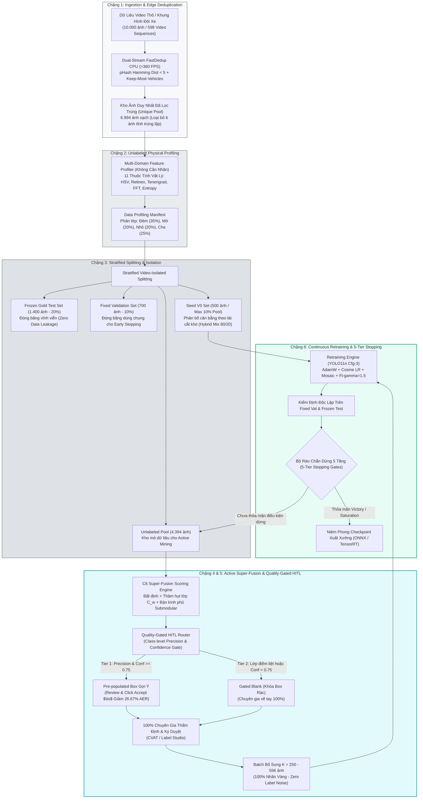
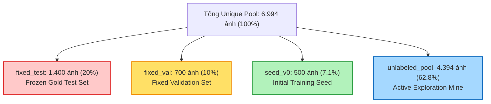

# 🏛️ KIẾN TRÚC HỆ THỐNG TOÀN TRÌNH & LUỒNG DỮ LIỆU (SYSTEM ARCHITECTURE & DATA FLOW)

> **Dự Án**: BDD10K Active Learning Lab — Hệ thống Tự Động Hóa Vòng Lặp Dữ Liệu Cho Thị Giác Xe Tự Hành  
> **Tác Giả**: Nguyễn Xuân Huỳnh  
> **Phiên Bản**: Production Release v4.0  
> **Tài Liệu**: Module 02 / Hệ Thống Kiến Trúc Kỹ Thuật

---

## 1. Tổng Quan Kiến Trúc Toàn Trình (High-Level Architecture)

Hệ thống BDD10K Active Learning Lab được thiết kế theo tư duy **Data-Centric AI chuẩn Production**. Thay vì liên tục tăng kích thước mô hình một cách thụ động, hệ thống xây dựng một **vòng lặp phản hồi đóng (Closed-Loop Flywheel)** tự động tinh tuyển dữ liệu giá trị cao nhất từ các luồng video thô chưa gán nhãn.



---

## 2. Chi Tiết 6 Chặng Dữ Liệu Liên Hoàn (The 6-Stage Pipeline)

### 2.1. Chặng 1: Ingestion & Dual-Stream FastDedup Tại Cạnh Biên
- **Đầu vào**: 10.000 khung hình thô trích xuất từ 598 video sequences của BDD10K.
- **Mục tiêu**: Loại bỏ triệt để các khung hình trùng lặp do xe dừng đèn đỏ hoặc kẹt xe mà không cần tới GPU.
- **Nguyên lý hoạt động**:
  - Dùng thuật toán **Perceptual Hashing (pHash)** với biến đổi Cosine rời rạc (DCT) $32 \times 32 \rightarrow 8 \times 8$ để tạo mã băm 64-bit.
  - Ngưỡng Hamming Distance: $HD < 5$ được xác định là điểm cân bằng Pareto tối ưu.
  - Cơ chế giải quyết xung đột **Keep-Most-Vehicles (KMV)**: Khi phát hiện 2 ảnh trùng lặp, thay vì giữ ảnh đầu tiên một cách mù quáng (Keep-First), thuật toán so sánh số lượng phương tiện có trong ảnh và giữ lại ảnh có mật độ phương tiện phong phú hơn.
- **Đầu ra**: 6.994 ảnh duy nhất (Unique Pool) lưu tại `data/processed/unique_pool/`.

### 2.2. Chặng 2: Multi-Domain Unlabeled Profiling
- **Đầu vào**: 6.994 ảnh duy nhất không có nhãn.
- **Mục tiêu**: Phân loại và trích xuất thuộc tính vật lý của từng ảnh phục vụ phân bổ mẫu cân bằng mà không cần ground-truth.
- **11 Thuộc tính vật lý được đo đạc**:
  1. Độ sáng trung bình (Mean Value kênh V trong HSV)
  2. Độ lệch chuẩn ánh sáng (Illumination Standard Deviation)
  3. Giá trị phản xạ Retinex Single-Scale (SSR)
  4. Năng lượng gradient cạnh Sobel / Tenengrad
  5. Phương sai toán tử Laplacian (Laplacian Variance Blur Metric)
  6. Tỷ lệ tần số cao trong miền biến đổi Fourier rời rạc (FFT High-Frequency Ratio)
  7. Shannon Entropy không gian màu xám
  8. Độ tương phản toàn cục RMS
  9. Mật độ chi tiết cục bộ (Local Edge Density)
  10. Tỷ lệ sắc độ bão hòa kênh S (Color Saturation)
  11. Chỉ số bóng tối cục bộ (Dark Channel Prior transmission)
- **Đầu ra**: `data/processed/reports/data_profiling_manifest.json` định danh 4 lát cắt dữ liệu: Ban đêm (Night: 35%), Vật thể nhỏ (Small: 20%), Che khuất (Occluded: 20%), Ban ngày tiêu chuẩn (Day: 25%).

### 2.3. Chặng 3: Stratified Splitting & Nguyên Tắc Cách Ly Dữ Liệu Tuyệt Đối
- **Đầu vào**: 6.994 ảnh duy nhất kèm profiling manifest.
- **Cơ chế phân tách 4 tập**:
  1. `data/splits/fixed_test/`: **1.400 ảnh (20.0%)** — Đóng băng vĩnh viễn (Frozen Gold Test Set). Đây là bài thi cuối kỳ chung, không bao giờ được chạm vào trong quá trình huấn luyện hay khai thác.
  2. `data/splits/fixed_val/`: **700 ảnh (10.0%)** — Tập validation cố định dùng chung cho Early Stopping của mọi mô hình.
  3. `data/splits/seed_v0/`: **500 ảnh (7.1% tổng / 10% pool)** — Tập mầm ban đầu huấn luyện Model V0, phân bổ theo thuật toán **Hybrid Mix 80/20** (bảo đảm phủ kín 10 lớp và 4 lát cắt khó).
  4. `data/splits/unlabeled_pool/`: **4.394 ảnh (62.8%)** — Kho mỏ dữ liệu chưa gán nhãn dành riêng cho Active Mining qua các vòng lặp.



### 2.4. Chặng 4: Quality-Gated Pre-Labeling Policy & Human Verification
- **Đầu vào**: Các bounding box dự đoán của mô hình hiện tại trên các ảnh được chọn từ Active Mining.
- **Cơ chế phân luồng hai tầng Quality-Gated (Class-Level Gate)**:
  - **Tier 1 (High-Confidence Pre-labeling)**: Các bounding box thuộc lớp mô hình đã đạt chuẩn (như `car` đạt Precision > 75%) và $Confidence \ge 0.75$ được sinh sẵn hộp gợi ý trên giao diện gán nhãn, chuyên gia chỉ cần kiểm tra nhanh và bấm xác nhận (**Review & Click Accept**) $\rightarrow$ Giảm **26.67% thời gian thao tác (AER)**.
  - **Tier 2 (Gated Manual Annotation)**: Các bounding box thuộc lớp điểm liệt hiểm hóc (`train`, `rider`, `motor`, `bike`) hoặc có $Confidence < 0.75$ bị **khóa box rác hoàn toàn (Blank)** nhằm tránh gây nhiễu cho annotator, bắt buộc chuyên gia phải vẽ tay thủ công 100%.
- **Zero Label Noise Principle**: Toàn bộ nhãn trước khi đưa vào tập huấn luyện tiếp sức (`seed_vk`, `train_vk`) đều bắt buộc phải được con người thẩm định 100%, tuyệt đối không nạp pseudo-labels chưa kiểm duyệt vào dữ liệu train nhằm triệt tiêu Confirmation Bias và Error Drift.

### 2.5. Chặng 5: Động Cơ Khai Thác C6 Super-Fusion & Diversity Mining
- **Hàm chấm điểm kết hợp đa yếu tố C6 Super-Fusion**:
  $$S(x_i) = U_i \times \left( \sum_{k=1}^{10} C_w^{(k)} \cdot G_w^{(k)} \right) \times E(x_i) \times B(x_i)$$
  Trong đó:
  - $U_i$: Độ bất định mô hình (Entropy dự đoán trung bình trên các bounding boxes).
  - $C_w^{(k)}$: Vector trọng số thâm hụt lớp động (Dynamic Class Deficit Weight), tự động tăng vọt ở các lớp mô hình đang yếu (`train`, `motor`, `rider`) và giảm về mức sàn $0.20\times$ ở lớp xe con (`car`).
  - $G_w^{(k)}$: Trọng số phân bổ hình học (vị trí gần trung tâm đường đi).
  - $E(x_i)$: Hệ số khó khăn môi trường từ profiling (ảnh đêm, mờ sương).
  - $B(x_i)$: Điểm phạt kích thước vật thể (Object Scale Bias).
- **Lọc đa dạng không gian Submodular Facility Location**:
  - Ánh xạ đặc trưng ảnh về không gian **PCA 32 chiều**.
  - Sử dụng thuật toán tham lam Submodular chọn ra $K$ ảnh sao cho tối đa hóa độ phân tán không gian và cực tiểu hóa bán kính bao phủ cực đại ($R_{\text{cov}}$).

### 2.6. Chặng 6: Continuous Retraining & Rào Chắn Dừng 5 Tầng (5-Tier Stopping Gates)
- **Cơ chế Tích lũy Dữ liệu Cũ + Mới (Cumulative Dataset Aggregation)**:
  - Ở mỗi vòng lặp $k$, tập huấn luyện không phải chỉ là các ảnh khó vừa bốc mà là **sự tích lũy lũy kế toàn bộ dữ liệu**:
    $$\mathcal{D}_{\text{train}}^{(V_k)} = \mathcal{D}_{\text{train}}^{(V_{k-1})} \cup \Delta \mathcal{D}_{\text{mined}}^{(k)} = \mathcal{D}_{\text{seed}}^{(V_0)} \cup \bigcup_{j=1}^{k} \Delta \mathcal{D}_{\text{mined}}^{(j)}$$
  - *Ma trận tăng trưởng dữ liệu*: V0 ($556$ ảnh) $\to$ V1 ($1.112$ ảnh) $\to$ V2 ($1.668$ ảnh) $\to$ V3 ($2.224$ ảnh) $\to$ V4 ($2.780$ ảnh) $\to$ V5 ($3.336$ ảnh = $60\%$ pool).
  - *Chống Quên thảm khốc (Zero Catastrophic Forgetting)*: Giữ toàn bộ $100\%$ dữ liệu cũ làm Anchor Set giúp mô hình không bị mất khả năng nhận diện các lớp cơ bản khi nạp thêm các ca biên khó.
- **Kế thừa Trọng số Siêu tốc (Warm-Start Continuous Fine-Tuning)**:
  - Trọng số khởi tạo vòng $k$: $\mathbf{W}_{\text{init}}^{(k)} \leftarrow \mathbf{W}_{\text{best}}^{(k-1)}$ (lấy checkpoint tốt nhất của vòng trước).
  - Huấn luyện tiếp sức chỉ cần 8-10 epochs, rút ngắn $70\%$ thời gian tính toán so với train from scratch.
- **Công thức huấn luyện Cfg-3 Quán Quân**:
  - Kiến trúc: Ultralytics YOLO11n (2.6M tham số, tốc độ suy luận siêu tốc).
  - Optimizer: `AdamW` với trọng số suy giảm `weight_decay = 0.0005`.
  - Schedule: `Cosine Annealing Learning Rate` (lr0 = 0.001, lrf = 0.01).
  - Augmentation: Mosaic = 1.0, Mixup = 0.15, Copy-Paste = 0.1.
  - Loss Function: Focal Loss $\gamma = 1.5$ giải quyết triệt để mất cân bằng lớp.
- **Bộ rào chắn dừng 5 tầng (5-Tier Stopping Gates)**:
  1. *Ceiling Victory Gate*: Dừng ngay khi $mAP_{\text{Active}} > mAP_{\text{Target 100\%}}$ liên tiếp 2 vòng.
  2. *Target Plateau Gate*: Dừng nếu mức tăng trưởng $\Delta mAP < 0.20\%$ qua 2 vòng lặp liên tiếp.
  3. *Knowledge Saturation Gate*: Dừng khi độ bất định toàn pool giảm dưới $20\%$ so với vòng mầm.
  4. *Low Uncertainty Gate*: Dừng khi số mẫu khó khai thác còn lại dưới ngưỡng tối thiểu.
  5. *Survival Limit Gate*: Ngắt khẩn cấp khi đạt mốc $80\%$ pool để bảo toàn ngân sách.

---

## 3. Cơ Chế Bảo Vệ Dữ Liệu Chuẩn Mực (Data Integrity Principles)

### 3.1. Zero Data Leakage Qua Video ID Isolation
Trong các bài toán xe tự hành, các khung hình kế tiếp nhau từ cùng một video clip hành trình thường rất giống nhau (tương quan không gian - thời gian cao). Nếu một khung hình ở giây thứ 1 nằm trong tập Train và khung hình ở giây thứ 2 nằm trong tập Test, mô hình sẽ bị rò rỉ dữ liệu nghiêm trọng (**Data Leakage**), dẫn đến kết quả đánh giá giả tạo.

**Quy tắc cô lập Video Sequence tuyệt đối**:
- BDD10K mã hóa tên file theo cấu trúc: `{video_id}-{frame_id}.jpg`.
- Toàn bộ 598 video sequences được gom nhóm theo `video_id`.
- Việc phân chia vào `fixed_test`, `fixed_val`, `seed_v0`, và `unlabeled_pool` được thực hiện **ở cấp độ Video Sequence**, bảo đảm:
  $$\text{Videos}(\text{Test}) \cap \text{Videos}(\text{Val}) \cap \text{Videos}(\text{Train}) = \emptyset$$
- Kiểm toán tự động qua 72 bài test xác nhận: **Tỷ lệ trùng lặp video = 0.00%**.

### 3.2. Quản Trị Dữ Liệu Read-Only $O(1)$ Symlink (Zero Storage Overhead)
- Thư mục gốc `data/bdd10k/` là **Read-Only 100% bất biến**.
- Mọi thao tác đổ dữ liệu vào `data/processed/` và `data/splits/` **hoàn toàn sử dụng Symbolic Link (Symlink)** trỏ trực tiếp về ảnh gốc.
- **Hiệu quả định lượng**:
  - Dung lượng đĩa phát sinh khi tạo hàng ngàn ảnh trong các tập split: **0 KB**.
  - Tốc độ khởi tạo tập dữ liệu mới: **<0.35 giây**.
  - Hoàn toàn tương thích native với PyTorch DataLoader, torchvision và Ultralytics engine.

### 3.3. Truy Xuất Metadata $O(1)$ Không Tạo File Trung Gian
- Tuyệt đối không tạo các thư mục `metadata/` hay `ground_truth/` phụ làm phân mảnh dự án.
- Mọi script và notebook đọc trực tiếp từ `data/bdd10k/bdd10k_metadata.json` ở chế độ Read-Only, dựng bảng băm:
  $$\text{LookupMap} = \{ \text{item}[\text{"name"}]: \text{item} \}$$
  cho phép truy xuất nhãn, bounding boxes và điều kiện môi trường với độ phức tạp thời gian **$O(1)$** theo tên ảnh.

---

## 4. Kiến Trúc 3 Tầng Lưu Trữ Chuẩn Mực (`raw` — `processed` — `splits`)

Dự án áp dụng cấu trúc phân tầng dữ liệu nghiêm ngặt:

```text
tang/
├── data/
│   ├── bdd10k/                              # [Tầng 0: Gốc Bất Biến - Read-Only 100%]
│   │   ├── images/train/                    # Kho ảnh vật lý gốc
│   │   └── bdd10k_metadata.json             # File metadata chân lý gốc
│   │
│   ├── raw/                                 # [Tầng 1: Vùng Dữ Liệu Thô Ban Đầu]
│   │   └── unlabeled_stream/                # Khung hình thu thập từ xe trước khi xử lý
│   │
│   ├── processed/                           # [Tầng 2: Kết Quả Xử Lý & Lọc Trùng]
│   │   ├── unique_pool/                     # Symlinks 6.994 ảnh duy nhất sạch sẽ
│   │   ├── dropped_duplicates/              # Symlinks các ảnh trùng lặp bị loại bỏ
│   │   └── reports/                         # Báo cáo profiling và manifest lọc trùng
│   │
│   └── splits/                              # [Tầng 3: Phân Chia Cho Active Learning]
│       ├── fixed_test/                      # 1.400 ảnh (20%) Frozen Gold Test Set
│       ├── fixed_val/                       # 700 ảnh (10%) Fixed Validation Set
│       ├── seed_v0/                         # 500 ảnh Tập mầm ban đầu huấn luyện Model V0
│       └── unlabeled_pool/                  # 4.394 ảnh Kho mỏ dữ liệu cho Active Mining
```

---

## 5. Tổng Kết Kiến Trúc

Kiến trúc 6 chặng liên hoàn cùng cơ chế bảo vệ dữ liệu nghiêm ngặt mang lại:
1. **Tính độc lập & khách quan tuyệt đối**: Tập Test cố định không bao giờ bị ô nhiễm.
2. **Khả năng tái lập 100%**: Mọi quyết định lấy mẫu đều có manifest JSON niêm phong hash SHA-256.
3. **Hiệu năng thực thi cao**: Toàn bộ luồng dữ liệu vận hành không độ trễ nhờ symlinks $O(1)$ và thuật toán lọc trùng CPU >360 FPS.

---
*Tài liệu thuộc hệ thống kiến trúc chuẩn Production của BDD10K Active Learning Lab.*
