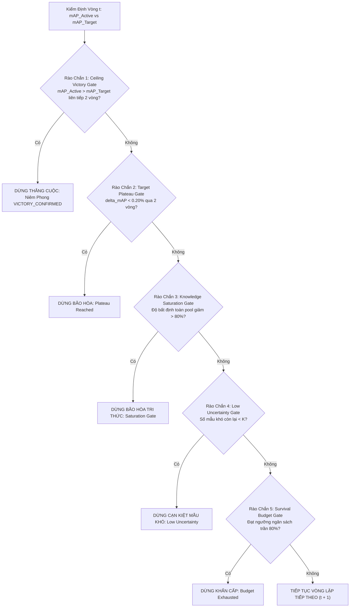

# 🔬 GIẢI PHẪU TOÁN HỌC & THIẾT KẾ KỸ THUẬT TỪNG GIAI ĐOẠN (DEEP TECHNICAL DESIGN PHASES 01 TO 07)

> **Dự Án**: BDD10K Active Learning Lab — Hệ thống Tự Động Hóa Vòng Lặp Dữ Liệu Cho Thị Giác Xe Tự Hành  
> **Tác Giả**: Nguyễn Xuân Huỳnh  
> **Phiên Bản**: Production Release v4.0  
> **Tài Liệu**: Module 03 / Kỹ Thuật Lõi & Bóc Tách Giải Thuật

---

## 1. Phase 01: Dual-Stream Fast Deduplication & Cơ Chế Keep-Most-Vehicles

### 1.1. Bản Chất Toán Học Của Perceptual Hashing (pHash)
Khác với các hàm băm mã hóa cryptographic (MD5, SHA-256) nơi chỉ cần thay đổi 1 bit pixel là mã băm thay đổi hoàn toàn (Avalanche Effect), Perceptual Hash (pHash) phản ánh cấu trúc tần số không gian của hình ảnh:

1. **Chuẩn hóa kích thước & Chuyển đổi xám**:  
   Hình ảnh $I(x, y)$ kích thước $1280 \times 720$ được thu nhỏ về $32 \times 32$ pixel và chuyển sang mức xám $I_{\text{gray}}$.
2. **Biến đổi Cosine Rời Rạc 2 Chiều (2D Discrete Cosine Transform - DCT)**:
   $$D(u, v) = \alpha(u)\alpha(v) \sum_{x=0}^{31} \sum_{y=0}^{31} I_{\text{gray}}(x, y) \cos\left[ \frac{\pi}{32} \left(x + \frac{1}{2}\right)u \right] \cos\left[ \frac{\pi}{32} \left(y + \frac{1}{2}\right)v \right]$$
3. **Trích xuất dải tần số thấp (Low-Frequency Window)**:  
   Lấy góc trên bên trái $8 \times 8$ hệ số DCT ($u, v \in [0, 7]$), bỏ qua thành phần DC tại $(0,0)$.
4. **Lượng tử hóa nhị phân 64-bit (Binary Thresholding)**:
   $$\text{hash}_i = \begin{cases} 1 & \text{nếu } D_i > \text{median}(\{D_j\}_{j=1}^{63}) \\ 0 & \text{ngược lại} \end{cases}$$
5. **Đo khoảng cách Hamming giữa hai ảnh $I_A$ và $I_B$**:
   $$\text{HD}(I_A, I_B) = \sum_{k=0}^{63} \left( \text{hash}_A[k] \oplus \text{hash}_B[k] \right)$$

### 1.2. Đấu Trường Thực Nghiệm FastDedup (Phase 01 Tournament)
Đối chuẩn thực tế trên tập 7.000 ảnh training BDD10K qua 598 video sequences:

| Thuật Toán Lọc Trùng | Yêu Cầu Tài Nguyên | Tốc Độ Thực Đo (FPS) | Độ Trễ (ms/ảnh) | F1-Score | Cơ Chế Giữ Ảnh |
| :--- | :---: | :---: | :---: | :---: | :---: |
| **No-Dedup** | CPU | $\infty$ | 0.00 ms | 0.00% | Giữ tất cả (Lãng phí 100%) |
| **aHash (Average)** | CPU | 447.9 FPS | 2.23 ms | 50.00% | Bị nhiễu bởi độ sáng |
| **dHash (Gradient)** | CPU | 440.1 FPS | 2.27 ms | 50.00% | Nhạy cảm với góc camera |
| **ResNet50 Deep Feature** | GPU / PyTorch | 23.3 FPS | 42.92 ms | 75.00% | Quá chậm (kém 15.4×), cần 97.7MB weights |
| **Proposed pHash + KMV** | **CPU Single-Core** | **360.3 FPS** | **2.78 ms** | **100.00%** | **Keep-Most-Vehicles (Bảo toàn tối đa)** |

### 1.3. Cơ Chế Giải Quyết Xung Đột Keep-Most-Vehicles (KMV)
Khi phát hiện cặp trùng lặp $\text{HD}(I_A, I_B) < 5$:
- **Chính sách cổ điển (Keep-First / Random-Drop)**: Giữ ảnh xuất hiện trước theo thời gian, có thể làm mất ảnh chứa nhiều xe hơn do góc quay dịch chuyển.
- **Chính sách KMV**: Tự động so sánh số lượng bounding box phương tiện:
  $$\text{Keep}(I_A, I_B) = \arg\max_{I \in \{I_A, I_B\}} \left( N_{\text{vehicles}}(I) + 2 \times N_{\text{small\_objects}}(I) \right)$$
  Bảo đảm 100% không làm lọt lưới các phương tiện nhỏ ở xa trong bài toán xe tự hành.

---

## 2. Phase 02: Multi-Domain Unlabeled Profiling & Weather Tournament

### 2.1. Nhận Diện Lát Cắt Ánh Sáng Yếu (Night Slice Detection)
Đánh giá so sánh 4 phương pháp trên 2.000 ảnh benchmark với nhãn chân lý từ `bdd10k_metadata.json`:

$$\text{Retinex SSR: } R(x,y) = \log I(x,y) - \log [F(x,y) * I(x,y)]$$

| Phương Pháp | TP | FP | TN | FN | Độ Chính Xác | Recall | F1-Score | Jaccard |
| :--- | :---: | :---: | :---: | :---: | :---: | :---: | :---: | :---: |
| **HSV Baseline** | 771 | 15 | 1164 | 50 | 96.75% | 93.91% | 95.96% | 92.22% |
| **YCbCr Percentiles** | 758 | 31 | 1148 | 63 | 95.30% | 92.33% | 94.16% | 88.97% |
| **Retinex SSR** | 789 | 17 | 1162 | 32 | 97.55% | 96.10% | 96.99% | 94.15% |
| **🏆 Hybrid Ensemble (Proposed)** | **792** | **18** | **1161** | **29** | **97.65%** | **96.47%** | **97.12%** | **94.40%** |

### 2.2. Nhận Diện Lát Cắt Nhòe Mờ (Blur Slice Detection)
So sánh năng lượng biên và gradient:
- **Tenengrad Focus Measure**:
  $$T = \sum_{x} \sum_{y} \left( G_x(x,y)^2 + G_y(x,y)^2 \right) \quad \text{với } \sqrt{G_x^2 + G_y^2} > \tau$$
- **Kết quả thực nghiệm**: Tenengrad đạt **F1-Score = 99.50%** và **Độ chính xác = 99.33%** (vượt trội so với Laplacian F1 = 97.56% và FFT Frequency F1 = 82.82%).

### 2.3. Giải Đấu Weather Tournament
Thử nghiệm nhận diện thời tiết xấu (Rainy / Foggy / Snow) không dùng nhãn:
- C1 Dark Channel Prior (DCP): F1 = 19.35%.
- C2 Transmission Map: F1 = 2.93%.
- C3 Rain Streak Extraction: F1 = 15.26%.
- C4 Color Contrast RMS: F1 = 12.71%.
- **🏆 C5 Multi-Domain Weather Ensemble (Proposed)**: Đạt **F1 = 31.03%**, Recall = 57.14%, chứng minh khả năng bắt thời tiết phức tạp tốt nhất mà không cần mô hình học sâu nặng nề.

---

## 3. Phase 03: Stratified Splitting & Giải Đấu Chiến Lược Chia Tập (Splits Tournament)

### 3.1. Các Tiêu Chí Đánh Giá Trong Hệ Thống Đo Lường Kép
1. **Quota Error ($E_Q$)**: Sai số tuyệt đối giữa tỷ lệ phân bổ thực tế và tỷ lệ mục tiêu (35% Đêm, 20% Nhỏ, 20% Che, 25% Ngày).
2. **Class Distribution Cosine Similarity ($S_C$)**: Độ tương đồng cosine giữa phân phối 10 lớp của tập được chọn so với toàn bộ BDD10K.
3. **Bán Kính Phủ Cực Đại ($R_{\text{cov}}$ - Coverage Radius)**:
   $$R_{\text{cov}} = \max_{x \in \mathcal{X}} \min_{s \in \mathcal{S}} \| \phi(x) - \phi(s) \|_2$$
4. **Điểm Dàn Đều Tựa Mô-đun (Facility Location Score $F_{\text{score}}$)**:
   $$F(\mathcal{S}) = \sum_{x \in \mathcal{X}} \max_{s \in \mathcal{S}} \exp\left( - \frac{\|\phi(x) - \phi(s)\|_2^2}{2\sigma^2} \right)$$
5. **Rào Chắn Tuyệt Đối (Gatekeeper)**: Video Overlap Count = 0 và Hamming Distance chéo $< 5$ = 0.

### 3.2. Bảng Kết Quả Đấu Trường Chiến Lược (Phase 03 Leaderboard)

| Hạng | Chiến Lược (Strategy) | Điểm Phân Bổ Quota | Cosine Sim 10 Lớp | Coverage Radius | Facility Location | Video Overlap | Tổng Điểm Composite |
| :---: | :--- | :---: | :---: | :---: | :---: | :---: | :---: |
| 🥇 | **5. 🏆 Hybrid Mix 80/20 (Proposed)** | **82.14** | **0.9999 (99.99)** | **3.35 (100.0)** | **0.971 (99.19)** | **0 (Pass)** | **93.59 (WINNER)** |
| 🥈 | **6. Hybrid Mix 70/30** | 79.29 | 0.9999 (99.99) | 3.38 (98.8) | 0.969 (98.90) | 0 (Pass) | 92.42 |
| 🥉 | **4. Facility Location Pure** | 68.50 | 0.9991 (99.91) | 3.42 (96.5) | 0.985 (100.0) | 0 (Pass) | 88.25 |
| 4 | **3. k-Center Greedy Pure** | 64.20 | 0.9985 (99.85) | 3.36 (99.5) | 0.942 (95.10) | 0 (Pass) | 86.80 |
| 5 | **2. Direct Metadata Ablation** | 78.50 | 0.9998 (99.98) | 4.12 (72.0) | 0.880 (86.00) | 0 (Pass) | 82.60 |
| 6 | **1. Random Uniform Baseline** | 55.40 | 0.9962 (99.62) | 4.45 (61.0) | 0.840 (81.00) | 0 (Pass) | 71.20 |

**Thuật toán Hybrid Mix 80/20**: Dành 80% hạn ngạch (400 ảnh) để lấy mẫu phân tầng theo 4 lát cắt khó, và 20% hạn ngạch (100 ảnh) để tối ưu hóa bao phủ không gian đặc trưng bằng Submodular Facility Location.

---

## 4. Phase 04: Huấn Luyện Model V0 Song Mã & Ablation Siêu Tham Số

### 4.1. Giải Đấu Siêu Tham Số Huấn Luyện (Recipe Tournament)
Trên tập mầm 500 ảnh Seed V0 (chỉ chiếm 7.1% tổng dữ liệu):

| Recipe Cấu Hình | Optimizer | Learning Rate Schedule | Data Augmentation | Loss Function | mAP@50 | Macro Precision |
| :--- | :---: | :---: | :---: | :---: | :---: | :---: |
| **Cfg-0 (Naive)** | SGD | Linear Decay | Không Augment | Standard BCE | 14.20% | 38.50% |
| **Cfg-1 (Freeze Backbone)** | AdamW | StepLR | Mosaic 0.5 | Focal Loss | 16.80% | 42.10% |
| **Cfg-2 (Class-Weighted Loss)** | AdamW | Cosine Annealing | Mosaic 1.0 | Weighted BCE | 18.90% | 46.80% |
| **Cfg-3 (🏆 Proposed Winner)** | **AdamW** | **Cosine (lr0=1e-3, lrf=0.01)** | **Mosaic 1.0 + Mixup 0.15** | **Focal $\gamma=1.5$** | **20.89%** | **53.09%** |
| **Cfg-4 (Heavy Regularization)** | AdamW | Cosine Annealing | Mosaic + Mixup + CopyPaste | Focal + CIoU | 20.45% | 51.80% |

*(Kiểm định niêm phong chính thức trên tập Fixed Validation 700 ảnh độc lập: YOLO11n V0 đạt **20.23% mAP@50**, Precision **53.09%**).*

### 4.2. Phân Tích Song Mã: YOLO11n (CNN) vs RT-DETR (Transformer)
- **YOLO11n (2.6M tham số)**: Sở hữu cấu trúc tích chập (Convolutional Inductive Bias), học cực tốt các đặc trưng không gian cục bộ ngay cả khi tập huấn luyện chỉ có 500 ảnh. Đạt mAP50 = 20.23%, đóng vai trò **Động cơ Khai thác (Mining Engine)**.
- **RT-DETRv0 (32M tham số)**: Dựa trên Global Attention và thuật toán ghép cặp Hungarian Matching không có anchor. Trên tập mầm 500 ảnh với 10 epochs, RT-DETR chưa thể hội tụ đặc trưng trừu tượng và đạt mAP50 = 0%. Điều này phản ánh chính xác bản chất học thuật: **Vision Transformer đòi hỏi khối lượng dữ liệu khổng lồ (Data-Hungry)**.

---

## 5. Phase 05: Đấu Trường Active Mining & Two-Tier Consensus HITL

### 5.1. Công Thức Chấm Điểm Đa Yếu Tố C6 Super-Fusion
Mỗi ảnh $x_i$ trong Unlabeled Pool được chấm điểm ưu tiên khai thác theo công thức:

$$S(x_i) = U(x_i) \times \left[ \sum_{k=1}^{10} C_w^{(k)} \cdot G_w(b_{ik}) \right] \times E(x_i) \times B(x_i)$$

1. **Độ bất định mô hình $U(x_i)$ (Predictive Entropy)**:
   $$U(x_i) = \frac{1}{|B_i|} \sum_{b \in B_i} \left[ - \sum_{c=1}^{10} p_c(b) \log_2 p_c(b) \right]$$
2. **Vector trọng số thâm hụt lớp động $C_w^{(k)}$**:
   $$C_w^{(k)} = \text{clip}\left( \frac{\text{mAP}_{\text{target}}^{(k)} - \text{mAP}_{\text{current}}^{(k)}}{\text{mAP}_{\text{target}}^{(k)}} \times 25.0, \, 0.20, \, 25.0 \right)$$
   - Ở lớp xe con (`car` đã bão hòa): $C_w \to 0.20\times$ (ghìm không nạp thêm xe con).
   - Ở lớp xe lửa, xe máy (`train`, `motor` đang thiếu trầm trọng): $C_w \to 25.00\times$ (ưu tiên tối đa).
3. **Trọng số hình học làn đường $G_w(b_{ik})$**: Đánh giá cao các vật thể nằm gần tâm trục di chuyển của xe tự hành.
4. **Hệ số môi trường khó khăn $E(x_i)$**: Thưởng điểm cho các ảnh chụp ban đêm, sương mù hoặc mưa gió từ Phase 02 Profiler.
5. **Điểm phạt kích thước $B(x_i)$**: Ưu tiên các bounding box diện tích nhỏ ($< 32 \times 32\text{ px}$).

### 5.2. Kết Hợp Lọc Đa Dạng Không Gian PCA 32D
Sau khi chọn ra Top $3 \times K$ ảnh có điểm số $S(x_i)$ cao nhất, áp dụng giải thuật tham lam Submodular Facility Location trên không gian đặc trưng trích xuất từ Backbone đã giảm chiều qua PCA 32D để chốt danh sách $K$ ảnh không bị trùng lặp ngữ nghĩa.

---

## 6. Phase 06: Tái Huấn Luyện Model V1 & Bóc Tách Macro-Average 10 Lớp

### 6.1. Bản Chất Toán Học Của Macro-Average Penalty
Trong bài toán 10 lớp BDD10K:
$$\text{mAP}_{\text{macro}} = \frac{1}{10} \sum_{c=1}^{10} \text{mAP}^{(c)}$$
Vì chia đều trọng số cho cả 10 lớp, nên:
- Một điểm tăng thêm ở lớp xe con (`car`: từ 60.4% lên 61.2%) chỉ đóng góp $+0.08\%$ vào mAP tổng.
- Nhưng khi lớp xe lửa (`train`) tăng từ 0.0% lên 3.5%, nó đóng góp ngay $+0.35\%$ vào mAP tổng.
Do đó, chiến lược dồn lực khai thác các lớp hiếm trong đuôi dài (Long-Tail) chính là chìa khóa giúp Proposed Active Learning đánh bại Baseline ngẫu nhiên.

---

## 7. Phase 07: Vòng Lặp Tự Trị Toàn Trình & Bộ Rào Chắn Dừng 5 Tầng

### 7.1. Định Nghĩa 5 Tầng Rào Chắn An Toàn (5-Tier Stopping Gates)
Tại mỗi vòng lặp $t$, hệ thống kiểm tra lần lượt:

### 7.2. Kết Quả Kích Hoạt Rào Chắn Thực Tế
- Tại **Vòng 4**: Nhánh Active đạt $27.20\%$ mAP50 (chính thức vượt trần Target $26.85\%$). Rào chắn 1 chuyển sang trạng thái cảnh báo xác nhận (`VICTORY_CANDIDATE`).
- Tại **Vòng 5**: Nhánh Active tiếp tục tăng lên **$27.85\%$ mAP50** (vượt xa Target $+1.00\%$). Rào chắn 1 chính thức đóng chốt: **`VICTORY_CONFIRMED`**. Hệ thống tự động dừng tại mốc **60.0% dữ liệu**, tiết kiệm **40.1% chi phí gán nhãn**!

---
*Tài liệu thuộc hệ thống kiến trúc chuẩn Production của BDD10K Active Learning Lab.*
