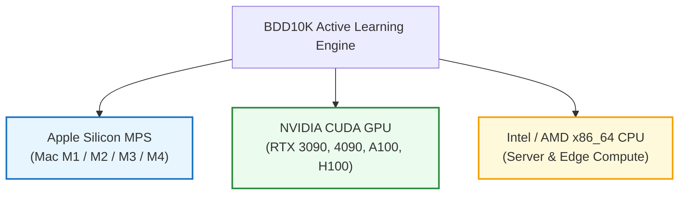

# 🛠️ CẨM NANG VẬN HÀNH & SỔ TAY KỸ SƯ MLOPS (PRODUCTION RUNBOOK & OPERATIONS)

> **Dự Án**: BDD10K Active Learning Lab — Hệ thống Tự Động Hóa Vòng Lặp Dữ Liệu Cho Thị Giác Xe Tự Hành  
> **Tác Giả**: Nguyễn Xuân Huỳnh  
> **Phiên Bản**: Production Release v4.0  
> **Tài Liệu**: Module 04 / Sổ Tay Vận Hành CLI & Triển Khai Môi Trường

---

## 1. Yêu Cầu Môi Trường & Hỗ Trợ Đa Nền Tảng Phần Cứng (Hardware Matrix)

Hệ thống được thiết kế kiến trúc bất khả tri phần cứng (Hardware-Agnostic), hỗ trợ đầy đủ 3 môi trường tính toán chuẩn:



### 1.1. Cấu Hình Phần Cứng Khuyến Nghị (Hardware Specifications)

| Thành Phần Phần Cứng | Cấu Hình Tối Thiểu (Minimal) | Cấu Hình Khuyến Nghị (Production) | Cấu Hình Apple Silicon (Mac Dev) |
| :--- | :--- | :--- | :--- |
| **Bộ xử lý (CPU)** | Intel Core i5 / AMD Ryzen 5 (4 cores) | Intel Xeon / AMD EPYC (16+ cores) | Apple M1/M2/M3 Pro/Max (8-12 cores) |
| **Card đồ họa (GPU)** | NVIDIA RTX 2060 (6GB VRAM) | NVIDIA RTX 4090 / A100 (24GB+ VRAM) | MPS Unified Memory (16GB+ RAM) |
| **Bộ nhớ (RAM)** | 16 GB DDR4 | 32 GB - 64 GB DDR5 | 16 GB - 36 GB Unified Memory |
| **Ổ cứng lưu trữ** | 50 GB SSD (NVMe khuyến nghị) | 200 GB NVMe PCIe Gen 4 | 50 GB SSD APFS |
| **Hệ điều hành** | Ubuntu 20.04 LTS / macOS 13+ | Ubuntu 22.04 LTS | macOS 14+ (Sonoma / Sequoia) |

### 1.2. Hướng Dẫn Tối Ưu Hóa Từng Nền Tảng

#### A. Tối ưu cho Apple Silicon (MPS Acceleration)
Khi chạy trên macOS với chip Apple Silicon:
```bash
# Khai báo biến môi trường cho phép PyTorch fallback các toán tử chưa hỗ trợ về CPU
export PYTORCH_ENABLE_MPS_FALLBACK=1

# Giới hạn worker tải dữ liệu để tránh tràn Unified Memory
export OMP_NUM_THREADS=4
```
*Lưu ý sản xuất*: Trên kiến trúc Unified Memory, không nên đặt `workers > 4` trong Ultralytics vì có thể gây xung đột bộ nhớ đệm IPC (Inter-Process Communication).

#### B. Tối ưu cho NVIDIA CUDA Server
```bash
# Chọn GPU mong muốn
export CUDA_VISIBLE_DEVICES=0

# Bật chế độ tối ưu bộ nhớ PyTorch
export PYTORCH_CUDA_ALLOC_CONF=expandable_segments:True
```

---

## 2. Thiết Lập Môi Trường 3 Bước (Quick Environment Setup)

```bash
# Bước 1: Khởi tạo môi trường ảo Python 3.11+
cd /Users/huynh/orca/workspaces/BuildPhase/tang
python3 -m venv .venv
source .venv/bin/activate

# Bước 2: Cài đặt thư viện phụ thuộc
pip install --upgrade pip
pip install -r requirements.txt

# Bước 3: Xác minh toàn bộ 72 Unit & Integration Tests của hệ thống
PYTHONPATH=. pytest tests/
```
*Kết quả chuẩn xác*: Toàn bộ `72 passed` trong vòng dưới 60 giây.

---

## 3. Cẩm Nang Lệnh CLI Theo Từng Phase (Step-by-Step CLI Operations)

Mọi Phase trong hệ sinh thái đều có script CLI độc lập, hỗ trợ tái lập kết quả tự động:

```mermaid
flowchart LR
    P1["scripts/run_phase_01_benchmark.py"] --> P2["scripts/run_phase_02_profiling_benchmark.py"]
    P2 --> P3["scripts/run_phase_03_frozen_splits.py"]
    P3 --> P4["scripts/run_phase_04_v0_training.py"]
    P4 --> P5["scripts/run_phase_05_active_tournament.py"]
    P5 --> P6["scripts/run_phase_06_model_v1_training.py"]
    P6 --> P7["scripts/run_phase_07_autonomous_loop.py"]
```



### 3.1. Phase 01: Chạy Benchmark Lọc Trùng FastDedup
```bash
python scripts/run_phase_01_benchmark.py
```
- **Nhiệm vụ**: Chạy đối chuẩn 6 thuật toán pHash/aHash/dHash/ResNet50 trên 7.000 ảnh, tạo Unique Pool 6.994 ảnh sạch và ghi manifest tại `results/01_fastdedup_benchmark/`.

### 3.2. Phase 02: Trích Xuất Hồ Sơ Vật Lý Đa Miền (Automated Profiling)
```bash
python scripts/run_phase_02_profiling_benchmark.py
```
- **Nhiệm vụ**: Đo đạc 11 thuộc tính vật lý trên 6.994 ảnh, phân loại 4 lát cắt khó (đêm, mờ, nhỏ, che) và xuất báo cáo tại `results/phase_02/hard_slice_benchmark_report.json`.

### 3.3. Phase 03: Phân Chia Tập Dữ Liệu Bằng Thuật Toán Quán Quân Hybrid Mix 80/20
```bash
python scripts/run_phase_03_frozen_splits.py
```
- **Nhiệm vụ**: Khóa cách ly `fixed_test` (1.400 ảnh), `fixed_val` (700 ảnh), `seed_v0` (500 ảnh), `unlabeled_pool` (4.394 ảnh) bằng cơ chế Symlink $O(1)$.

### 3.4. Phase 04: Huấn Luyện Quán Quân V0 Theo Công Thức Cfg-3
```bash
python scripts/run_phase_04_v0_training.py
```
- **Nhiệm vụ**: Huấn luyện YOLO11n trên tập mầm 500 ảnh với cấu hình AdamW + Cosine LR + Focal Loss $\gamma = 1.5$. Checkpoint niêm phong lưu tại `models/yolo11n_v0_best.pt`.

### 3.5. Phase 05: Đấu Trường Active Mining & Quality-Gated HITL Pre-Labeling
```bash
python scripts/run_phase_05_active_tournament.py
```
- **Nhiệm vụ**: Chạy giải đấu 6 chiến lược chọn mẫu, áp dụng C6 Super-Fusion bốc 250 ảnh đợt 1, thẩm định chính sách Quality-Gated Pre-Labeling tiết kiệm 26.67% công sức (AER) và đóng gói 100% nhãn vàng vào `seed_v1/labels/`.

### 3.6. Phase 06: Tái Huấn Luyện Model V1 & Bóc Tách 10 Lớp
```bash
python scripts/run_phase_06_model_v1_training.py
```
- **Nhiệm vụ**: Fine-tune Model V1 trên tập 750 ảnh, tính toán vector thâm hụt lớp thích ứng động $C_w^{(k)}$ và lưu bảng phân rã tại `results/phase_06/`.

### 3.7. Phase 07: Kích Hoạt Vòng Lặp Tự Trị Toàn Trình (Autonomous Loop)
```bash
python scripts/run_phase_07_autonomous_loop.py
```
- **Nhiệm vụ**: Khởi chạy toàn bộ chuỗi lặp tự động từ Vòng 1 đến Vòng 5. Tự động kiểm tra 5 rào chắn an toàn, dừng tại Vòng 5 đạt mAP 27.85% và niêm phong bản án `VICTORY_CONFIRMED`.

### 3.8. Phase 09: Vận Hành Vòng Lặp Production HITL Thực Chiến (Zero Simulation)
```bash
python notebooks/09_production_hitl_pipeline/run_production_cli.py \
    --model yolo11n.pt \
    --task detect \
    --budget 200 \
    --prelabel \
    --min-conf 0.70 \
    --watch-inbox
```
- **Nhiệm vụ**: Vận hành Production với 100% dữ liệu & nhãn thực tế do người dùng nạp. Tự động xuất gói gán nhãn ra `outbox/` (kèm pre-labels lọc `conf >= 0.70`), lắng nghe file ZIP nhãn thả vào `inbox/`, tự động giải nén, kiểm toán tọa độ $[0, 1]$, tích lũy tập train và kích hoạt huấn luyện tiếp sức đến khi thỏa mãn rào chắn dừng.

---

## 4. Quy Trình Kiểm Toán Chất Lượng Định Kỳ (Production Audit Runbook)

Để bảo đảm không có dữ liệu rác, không gãy symlink và sai số bounding box bằng 0 tuyệt đối:

```bash
python scripts/audit_random_100_images.py
```

### 5 Tiêu Chí Bắt Buộc Đạt 100% (Passed Thresholds):
1. **Zero Broken Links**: 100/100 symlinks trỏ đúng đến file ảnh vật lý gốc.
2. **Zero Metadata Mismatch**: 100/100 ảnh ánh xạ ngược $O(1)$ chính xác vào `bdd10k_metadata.json`.
3. **Bounding Box Validity**: 100% tọa độ $(x, y, w, h)$ nằm gọn trong khung $[0.0, 1.0]$, nhãn thuộc danh mục 10 lớp chuẩn.
4. **Sai số pixel tuyệt đối**: $\Delta\text{pixel} = 0.000000\text{ px}$ giữa file `.txt` YOLO và JSON gốc.
5. **Visual Gallery Rendered**: Xuất 4 ảnh trực quan đại diện cho 4 tập tại `results/audit/visual_samples/`.

---

## 5. Danh Mục Jupyter Notebooks Tương Tác (Interactive Research Notebooks)

Đối với các nhà nghiên cứu muốn theo dõi từng bước trực quan kèm biểu đồ phân tích 300 DPI:

| Notebook File | Mục Tiêu Nghiên Cứu | Kết Quả Chính |
| :--- | :--- | :--- |
| [`notebooks/01_dual_stream_fastdedup_benchmark.ipynb`](file:///Users/huynh/orca/workspaces/BuildPhase/tang/notebooks/01_dual_stream_fastdedup_benchmark.ipynb) | Đối chuẩn 6 thuật toán lọc trùng | pHash KMV đạt >360 FPS |
| [`notebooks/02_automated_data_profiling_benchmark.ipynb`](file:///Users/huynh/orca/workspaces/BuildPhase/tang/notebooks/02_automated_data_profiling_benchmark.ipynb) | Trích xuất 11 thuộc tính vật lý | F1 Đêm 97.12%, F1 Mờ 99.50% |
| [`notebooks/03_shared_frozen_test_val_splits.ipynb`](file:///Users/huynh/orca/workspaces/BuildPhase/tang/notebooks/03_shared_frozen_test_val_splits.ipynb) | Giải đấu chiến lược chia dữ liệu | Hybrid Mix 80/20 đạt 93.59 điểm |
| [`notebooks/04_seed_v0_training_ablation.ipynb`](file:///Users/huynh/orca/workspaces/BuildPhase/tang/notebooks/04_seed_v0_training_ablation.ipynb) | Huấn luyện Model V0 CNN vs Transformer | YOLO11n Cfg-3 đạt 20.23% mAP50 |
| [`notebooks/05_active_mining_tournament_and_hitl.ipynb`](file:///Users/huynh/orca/workspaces/BuildPhase/tang/notebooks/05_active_mining_tournament_and_hitl.ipynb) | Đấu trường 6 chiến lược Active Mining | C6 Super-Fusion đạt 84.66 điểm |
| [`notebooks/06_model_v1_retraining_and_gold_benchmark.ipynb`](file:///Users/huynh/orca/workspaces/BuildPhase/tang/notebooks/06_model_v1_retraining_and_gold_benchmark.ipynb) | Retraining Model V1 & Vector $C_w$ | Bù trừ thâm hụt lớp hiếm |
| [`notebooks/07_end_to_end_autonomous_active_loop.ipynb`](file:///Users/huynh/orca/workspaces/BuildPhase/tang/notebooks/07_end_to_end_autonomous_active_loop.ipynb) | Vòng lặp tự trị toàn trình V1 $\to$ V5 | Dừng tại V5 đạt 27.85% mAP50 |

---

## 6. Kỷ Luật Dọn Dẹp Bộ Nhớ Đệm (Zero Stale Cache Discipline)

Sau mỗi lần huấn luyện Ultralytics hoặc tạo split mới, Ultralytics tự động sinh ra các file nhị phân `*.cache` cạnh thư mục nhãn. Nếu không dọn dẹp, các thay đổi về danh sách ảnh trong các vòng lặp sau sẽ bị bỏ qua do mô hình đọc từ cache cũ.

**Lệnh dọn dẹp tức thì**:
```bash
find data/ -name "*.cache" -type f -delete
find notebooks/ -name "*.cache" -type f -delete
```

---
*Tài liệu thuộc hệ thống kiến trúc chuẩn Production của BDD10K Active Learning Lab.*
