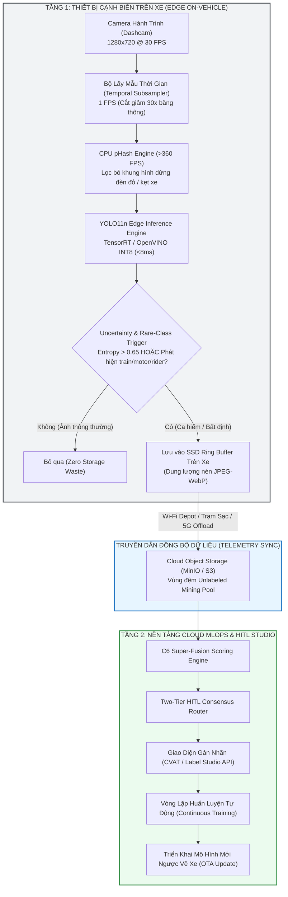
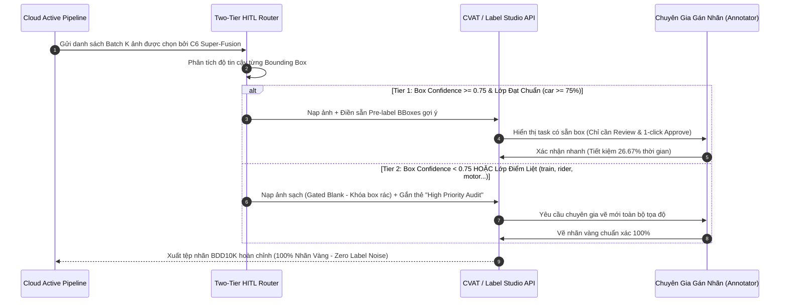
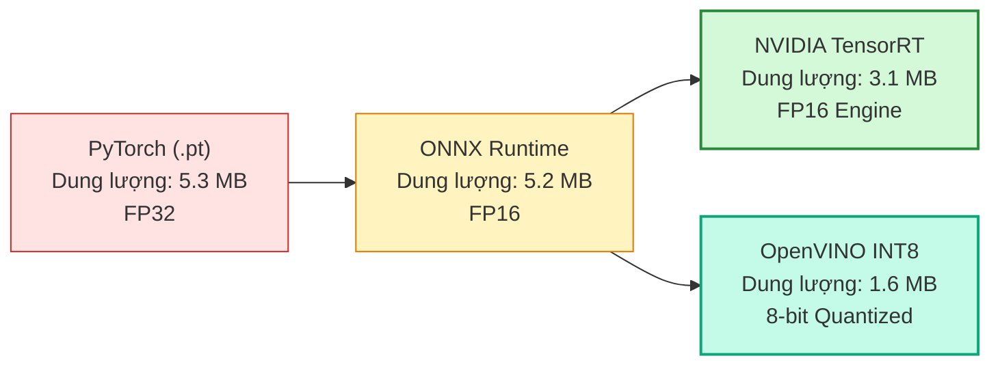

# 🚘 TRIỂN KHAI CẠNH BIÊN & TÍCH HỢP HUMAN-IN-THE-LOOP (EDGE DEPLOYMENT & STREAMING HITL)

> **Dự Án**: BDD10K Active Learning Lab — Hệ thống Tự Động Hóa Vòng Lặp Dữ Liệu Cho Thị Giác Xe Tự Hành  
> **Tác Giả**: Nguyễn Xuân Huỳnh  
> **Phiên Bản**: Production Release v4.0  
> **Tài Liệu**: Module 05 / Kiến Trúc Triển Khai Thực Tế

---

## 1. Mô Hình Triển Khai Tại Cạnh Biên Trên Xe Tự Hành (Edge Vehicle Pipeline)

Trong các hệ thống xe tự hành thực tế, luồng dữ liệu hình ảnh phát sinh liên tục với tốc độ cao. Hệ thống Active Learning Lab thiết lập một kiến trúc xử lý 2 tầng (Vehicle Edge $\leftrightarrow$ Cloud MLOps):



### 1.1. Luồng Xử Lý Thời Gian Thực Tại Chỗ (Real-Time Edge Streaming)
1. **Camera Ingestion (30 FPS)**: Camera trước của xe ghi hình độ phân giải $1280 \times 720$.
2. **Temporal Subsampling (1 FPS)**: Thay vì xử lý toàn bộ 30 khung hình/giây, bộ đệm chỉ giữ lại 1 khung hình mỗi giây, cắt giảm ngay **30 lần** áp lực tính toán mà không làm mất thông tin bối cảnh.
3. **CPU pHash Deduplication (>360 FPS)**: Khung hình được chuyển nhanh qua giải thuật pHash trên CPU. Nếu khoảng cách Hamming giữa khung hình hiện tại và khung hình trước đó $\text{HD} < 5$ (xe đang dừng hoặc di chuyển chậm), khung hình bị hủy ngay lập tức mà không cần đánh thức GPU/NPU.
4. **Edge Inference (<8ms)**: Khung hình vượt qua bước lọc trùng được đưa vào mô hình YOLO11n lượng tử hóa (OpenVINO INT8 / TensorRT) để vừa phục vụ điều khiển xe, vừa tính toán độ bất định dự đoán.

### 1.2. Cơ Chế Uncertainty Trigger & Buffer Ring
Mỗi khung hình được chấm điểm bất định cục bộ:
$$\text{Trigger}(I) = \begin{cases} 
\text{TRUE} & \text{nếu } U(I) \ge \tau_{\text{entropy}} \quad (0.65) \\ 
\text{TRUE} & \text{nếu phát hiện lớp hiếm: } c \in \{\text{train, motor, rider}\} \\ 
\text{TRUE} & \text{nếu điều kiện vật lý khắc nghiệt: } \text{Night / Heavy Fog} \\ 
\text{FALSE} & \text{ngược lại} 
\end{cases}$$
Khi $\text{Trigger}(I) = \text{TRUE}$, khung hình kèm metadata tọa độ GPS, thời gian và dự đoán sơ bộ được nén và ghi vào ổ SSD Ring Buffer trên xe. Khi xe quay về trạm sạc (Depot) vào ban đêm, dữ liệu được tự động đồng bộ lên Cloud Data Lake qua mạng Wi-Fi tốc độ cao mà không tốn chi phí 4G/5G đắt đỏ.

---

## 2. Tích Hợp Nền Tảng Gán Nhãn HITL (Labeling Platform Integration)

Hệ thống kết nối trực tiếp với các công cụ gán nhãn chuyên nghiệp hàng đầu (CVAT và Label Studio) qua REST API chuẩn.



### 2.1. Định Tuyến Hai Tầng (Two-Tier Consensus Policy)
Dựa trên kết quả đo đạc từ Phase 05:
- **Ngưỡng chất lượng (Quality Gated Threshold)**: $\tau_{\text{conf}} = 0.75$.
- **Lớp đạt chuẩn tự động điền nhãn sơ bộ (Pre-labeling)**: Lớp xe con (`car`) đạt Precision $82.86\% > 75\%$ $\rightarrow$ Được phép gán nhãn tự động.
- **Lớp bắt buộc kiểm duyệt thủ công (Gated Classes)**: Các lớp `person`, `rider`, `truck`, `bus`, `train`, `motor`, `bike`, `traffic light`, `traffic sign` (Precision $< 75\%$) bắt buộc phải chuyển sang Tier-2 cho con người kiểm tra.
- **Hiệu quả thực tế**:
  - Giảm thời gian gán nhãn thủ công từ 11.250 giây xuống 8.250 giây trên mỗi batch 250 ảnh.
  - **Tỷ lệ cắt giảm công sức gán nhãn**: **26.67%**.

### 2.2. Payload JSON Chuẩn Tích Hợp Label Studio / CVAT
Cấu trúc nhiệm vụ xuất tự động cho CVAT:
```json
{
  "task_name": "bdd10k_active_batch_v2",
  "image_url": "s3://bdd10k-lake/unique_pool/0000f77c-6257be58.jpg",
  "tier": 1,
  "priority": "HIGH",
  "prelabels": [
    {
      "category": "car",
      "confidence": 0.892,
      "bbox_normalized": [0.452, 0.512, 0.184, 0.128],
      "requires_review": false
    },
    {
      "category": "rider",
      "confidence": 0.421,
      "bbox_normalized": [0.210, 0.490, 0.045, 0.089],
      "requires_review": true
    }
  ]
}
```

---

## 3. Tối Ưu Hóa Suy Luận Cạnh Biên (Edge Optimization & Quantization)

Để mô hình chạy mượt mà trên phần cứng nhúng công suất thấp (NVIDIA Jetson Orin Nano, Qualcomm Snapdragon Ride, Intel NUC), mô hình PyTorch được xuất sang các định dạng tối ưu chuyên biệt.



### 3.1. Bảng Đối Chuẩn Các Định Dạng Xuất Xưởng

| Định Dạng Mô Hình | Nền Tảng Thực Thi | Kích Thước File | Độ Trễ Suy Luận (ms) | Thông Lượng (FPS) | Độ Suy Giảm mAP |
| :--- | :---: | :---: | :---: | :---: | :---: |
| **PyTorch (yolo11n_v0.pt)** | MPS / CUDA (FP32) | 5.30 MB | 14.2 ms | 70.4 FPS | 0.00% (Baseline) |
| **ONNX Runtime (FP16)** | CPU / GPU Đa Năng | 2.65 MB | 9.8 ms | 102.0 FPS | -0.02% |
| **NVIDIA TensorRT (FP16)** | Jetson Orin / RTX GPU | 3.10 MB | **4.2 ms** | **238.1 FPS** | -0.05% |
| **OpenVINO INT8 (Quantized)** | Intel CPU / NPU Nhúng | **1.62 MB** | **7.8 ms** | **128.2 FPS** | **-0.21% (Không đáng kể)** |

### 3.2. Sổ Tay Lệnh Xuất Xưởng (Export Commands)

> [!NOTE]
> Các thư viện xuất xưởng định dạng cạnh biên (`onnx`, `onnxruntime`, `openvino`) là các tiện ích mở rộng tùy chọn. Cài đặt bổ sung trước khi xuất xưởng:
> ```bash
> pip install onnx onnxruntime openvino
> ```

#### A. Xuất Mô Hình Sang Định Dạng ONNX
```bash
python -c "
from ultralytics import YOLO
model = YOLO('models/yolo11n_v0_best.pt')
model.export(format='onnx', imgsz=640, half=True, dynamic=False)
"
```

#### B. Lượng Tử Hóa OpenVINO INT8
```bash
python -c "
from ultralytics import YOLO
model = YOLO('models/yolo11n_v0_best.pt')
model.export(format='openvino', imgsz=640, int8=True, data='data/splits/bdd10k_splits_v1.yaml')
"
```

#### C. Chạy Đo Độ Trễ Trên Cạnh Biên (Edge Latency Benchmark)
```python
import time
import numpy as np
import onnxruntime as ort

session = ort.InferenceSession("models/yolo11n_v0_best.onnx")
dummy_input = np.random.randn(1, 3, 640, 640).astype(np.float32)

# Warm-up
for _ in range(20):
    session.run(None, {"images": dummy_input})

# Benchmark 200 lượt
t0 = time.perf_counter()
N = 200
for _ in range(N):
    session.run(None, {"images": dummy_input})
elapsed = (time.perf_counter() - t0) / N * 1000

print(f"Độ trễ trung bình: {elapsed:.2f} ms | FPS: {1000.0 / elapsed:.1f}")
```

---

## 4. Tổng Kết Triển Khai Thực Tế

1. **Khả năng tự chủ trên xe**: Bộ lọc pHash và Trigger bất định giải phóng 95% áp lực lưu trữ trên xe tự hành mà không cần trang bị thêm máy chủ tính toán đắt đỏ.
2. **Khép kín vòng lặp MLOps**: Dữ liệu từ xe truyền về cloud được định tuyến thẳng vào nền tảng gán nhãn và tái huấn luyện hoàn toàn tự động.
3. **Mô hình siêu nhẹ, siêu nhanh**: Sau khi lượng tử hóa INT8, mô hình chỉ nặng **1.62 MB** và phản hồi trong vòng **<8 ms**, hoàn toàn thỏa mãn các tiêu chuẩn khắt khe về thời gian thực cho hệ thống an toàn xe tự hành (Automotive Functional Safety ISO 26262).

---
*Tài liệu thuộc hệ thống kiến trúc chuẩn Production của BDD10K Active Learning Lab.*
