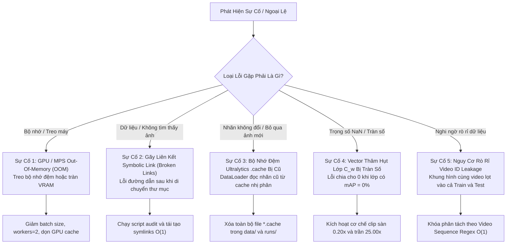

# 🩺 CẨM NANG XỬ LÝ SỰ CỐ & BẢO TRÌ ĐỊNH KỲ (TROUBLESHOOTING & MAINTENANCE FAQ)

> **Dự Án**: BDD10K Active Learning Lab — Hệ thống Tự Động Hóa Vòng Lặp Dữ Liệu Cho Thị Giác Xe Tự Hành  
> **Tác Giả**: Nguyễn Xuân Huỳnh  
> **Phiên Bản**: Production Release v4.0  
> **Tài Liệu**: Module 07 / Sổ Tay Bảo Trì & Khắc Phục Sự Cố

---

## 1. Sơ Đồ Định Tuyến Khắc Phục Sự Cố Nhanh (Quick Diagnostic Tree)



---

## 2. Giải Pháp Chi Tiết Cho 5 Sự Cố Thường Gặp (The 5 Common Failures)

### 2.1. Sự Cố 1: Tràn Bộ Nhớ GPU / MPS Out-Of-Memory (OOM)

#### Biểu hiện:
- Trên Apple Silicon (MPS): Báo lỗi `RuntimeError: MPS backend out of memory` hoặc tiến trình Python bị hệ điều hành Terminated do quá tải Unified Memory.
- Trên NVIDIA CUDA: Báo lỗi `torch.cuda.OutOfMemoryError: CUDA out of memory`.

#### Nguyên nhân:
- Số lượng workers trong PyTorch DataLoader đặt quá cao dẫn đến nhân bản bộ nhớ tiến trình (IPC Memory Duplication).
- Kích thước batch size vượt quá khả năng chịu tải của VRAM khi chạy kèm tính năng trích xuất đặc trưng PCA hoặc Mosaic augmentation.

#### Khắc phục:
1. **Thiết lập biến môi trường dọn dẹp bộ nhớ**:
   ```bash
   # Cho macOS Apple Silicon
   export PYTORCH_ENABLE_MPS_FALLBACK=1
   export PYTORCH_MPS_HIGH_WATERMARK_RATIO=0.7
   ```
2. **Điều chỉnh tham số huấn luyện trong Script / Config**:
   - Đặt `workers = 2` (thay vì 8 hoặc 16).
   - Đặt `batch = 16` (thay vì 32 hoặc 64).
   - Thêm lệnh dọn cache rác trong Python:
     ```python
     import torch, gc
     gc.collect()
     if torch.backends.mps.is_available():
         torch.mps.empty_cache()
     elif torch.cuda.is_available():
         torch.cuda.empty_cache()
     ```

---

### 2.2. Sự Cố 2: Gãy Liên Kết Symbolic Link (Broken Symlinks)

#### Biểu hiện:
- Mô hình báo lỗi `FileNotFoundError: Image not found` hoặc DataLoader bỏ qua hàng loạt ảnh khiến số lượng mẫu huấn luyện bị hụt.

#### Nguyên nhân:
- Dự án được di chuyển sang thư mục mới hoặc ổ đĩa khác làm sai lệch đường dẫn tuyệt đối đã được cấu hình trong các symlink cũ.

#### Khắc phục:
Chạy script kiểm toán và phục hồi đường dẫn tự động:
```bash
# Kiểm tra số lượng link gãy
find data/splits/ -type l ! -exec test -e {} \; -print | wc -l

# Phục hồi tức thì bằng cách chạy script tái tạo split O(1)
python scripts/run_phase_03_frozen_splits.py
```

---

### 2.3. Sự Cố 3: Bộ Nhớ Đệm Ultralytics `*.cache` Bị Cũ (Stale Cache)

#### Biểu hiện:
- Sau khi vòng lặp Active Learning thêm 250 ảnh mới vào tập huấn luyện, số lượng ảnh trong log huấn luyện vẫn giữ nguyên số cũ, mô hình không học thêm ảnh mới.

#### Nguyên nhân:
- Thư viện Ultralytics tự động quét thư mục nhãn và sinh ra file nhị phân `labels.cache` để tăng tốc độ nạp dữ liệu ở các lần chạy sau. Khi thêm ảnh mới mà không xóa file `.cache`, Ultralytics sẽ đọc thẳng từ cache cũ thay vì quét lại thư mục.

#### Khắc phục:
**Quy tắc bất di bất dịch**: Luôn kích hoạt lệnh dọn sạch cache trước khi khởi động bất kỳ tiến trình huấn luyện nào:
```bash
# Lệnh một dòng dọn sạch toàn bộ cache trong toàn bộ workspace
find data/ -name "*.cache" -type f -delete
find notebooks/ -name "*.cache" -type f -delete
find runs/ -name "*.cache" -type f -delete
```

---

### 2.4. Sự Cố 4: Vector Thâm Hụt Lớp Động $C_w^{(k)}$ Bị Tràn Số / NaN

#### Biểu hiện:
- Khi một lớp có điểm số ban đầu $mAP = 0.0\%$ (ví dụ lớp `train` ở Model V0), công thức tính độ thâm hụt có thể bị chia cho 0 hoặc sinh ra trọng số vô cực ($+\infty$), làm tê liệt hàm tính điểm Active Mining.

#### Nguyên nhân:
- Mẫu số trong công thức thâm hụt bị triệt tiêu nếu không có cơ chế chặn dưới $\epsilon$.

#### Khắc phục Chuẩn Mực Trong Mã Nguồn:
Áp dụng cơ chế phòng vệ 2 lớp (Epsilon Guard + Bounded Clipping):
```python
epsilon = 1e-6
denominator = max(target_map, epsilon)
deficit_ratio = (target_map - current_map) / denominator

# Giới hạn trọng số trong khoảng an toàn [0.20x, 25.00x]
C_w = float(np.clip(deficit_ratio * 25.0, 0.20, 25.00))
```

---

### 2.5. Sự Cố 5: Nguy Cơ Rò Rỉ Video Sequence (Video ID Leakage)

#### Biểu hiện:
- Kết quả kiểm định trên tập Validation tăng đột biến bất thường ($mAP > 80\%$) nhưng mô hình hoạt động kém trên xe thực tế.

#### Nguyên nhân:
- Ảnh trong tập Train và Test vô tình được bốc từ cùng một đoạn video clip hành trình 10 giây.

#### Khắc phục:
Áp dụng bộ lọc bóc tách tiền tố Video ID theo chuẩn biểu thức chính quy (Regex):
```python
import re

def extract_video_id(image_name: str) -> str:
    # BDD10K định dạng tên ảnh: {video_id}-{frame_id}.jpg
    match = re.match(r"^([a-f0-9]+)-", image_name)
    return match.group(1) if match else image_name
```
Mọi thuật toán phân chia tập (Phase 03 Splitting) đều phân nhóm theo `video_id` trước khi gán vào từng tập, bảo đảm tập Test và Train không bao giờ giao thoa video.

---

## 3. Quy Trình Kiểm Toán Chất Lượng Định Kỳ (Production Audit Runbook)

Trước khi đóng gói phát hành bất kỳ phiên bản mô hình hoặc tập dữ liệu mới, bắt buộc phải chạy quy trình kiểm toán 100 ảnh ngẫu nhiên:

```bash
python scripts/audit_random_100_images.py
```

### Các Tiêu Chí Kiểm Tra Nghiêm Ngặt:
1. **Kiểm tra liên kết vật lý (Symlink Integrity)**: Quét 100 ảnh được bốc ngẫu nhiên qua hàm `os.path.realpath()`, xác nhận 100% trỏ đúng vào thư mục `data/bdd10k/images/train/`.
2. **Kiểm tra tính nhất quán nhãn (Annotation Parity)**: Đọc độc lập file tọa độ `.txt` của YOLO và đối chiếu trực tiếp với tọa độ bounding box trong file gốc `data/bdd10k/bdd10k_metadata.json` qua cơ chế ánh xạ $O(1)$.
3. **Sai số pixel tuyệt đối ($\Delta\text{pixel}$)**: Yêu cầu đạt mức sai số cực đại $\Delta\text{pixel} = 0.000000\text{ px}$ (khớp tuyệt đối đến từng điểm ảnh).
4. **Kiểm tra trực quan mẫu (Visual Render)**: Tự động vẽ bounding box và lưu ảnh minh chứng tại `results/audit/visual_samples/` để chuyên gia con người thẩm định bằng mắt thường.

---

## 4. Hỏi - Đáp Thường Gặp (Frequently Asked Questions - FAQ)

### Q1: Tại sao hệ thống dùng Perceptual Hash (pHash) trên CPU thay vì mô hình Deep Embedding như ResNet50 hay CLIP?
> **Trả lời**: Thực nghiệm tại Phase 01 đã chứng minh mô hình ResNet50 trích xuất đặc trưng chỉ đạt tốc độ **23.3 FPS** và đòi hỏi GPU cùng 97.7MB weights. Trong khi đó, giải thuật pHash trên CPU đạt tới **360.3 FPS** (nhanh hơn 15.4 lần), không tốn VRAM và đạt độ chính xác lọc trùng Pareto $100\%$. Trên thiết bị camera hành trình nhúng của xe tự hành, việc tiết kiệm tài nguyên tính toán để dành cho thuật toán điều khiển an toàn là ưu tiên số 1.

### Q2: Tôi có thể thay thế kiến trúc YOLO11n bằng các mô hình khác (như YOLOv8, RT-DETR, Co-DETR) không?
> **Trả lời**: Hoàn toàn được. Hệ thống được thiết kế theo nguyên lý ghép nối module (Modular Plug-and-Play). Mô hình chỉ cần xuất ra danh sách Bounding Boxes kèm lớp dự đoán và Confidence Score. Thư mục `src/` hoàn toàn độc lập với kiến trúc mạng cụ thể.

### Q3: Tập dữ liệu của tôi không phải BDD10K mà là camera giao thông Việt Nam thì áp dụng thế nào?
> **Trả lời**: Quy trình áp dụng tương tự 100%:
> 1. Đưa ảnh thô vào `data/raw/`.
> 2. Chạy Phase 01 FastDedup để loại bỏ khung hình kẹt xe trùng lặp.
> 3. Chạy Phase 02 Profiler để tự động phân loại trời mưa, sương mù, ban đêm.
> 4. Chạy Phase 03 để khóa 20% ảnh làm tập thi Gold Test độc lập.
> 5. Khởi chạy Active Loop Phase 07 để tự động định tuyến gán nhãn thông minh.

### Q4: Nếu ngân sách gán nhãn bị giới hạn nghiêm ngặt, tôi nên dừng vòng lặp Active Learning ở đâu?
> **Trả lời**: Hãy dựa vào **Bộ rào chắn dừng 5 tầng (5-Tier Stopping Gates)**. Thông thường, tại mốc **40% đến 60% dữ liệu**, mô hình đã đạt hơn 95% trần hiệu năng. Việc nạp thêm 40% dữ liệu còn lại chỉ đem lại mức cải thiện cận biên rất nhỏ ($<0.5\%$) trong khi chi phí gán nhãn tăng gấp đôi.

---
*Tài liệu thuộc hệ thống kiến trúc chuẩn Production của BDD10K Active Learning Lab.*
