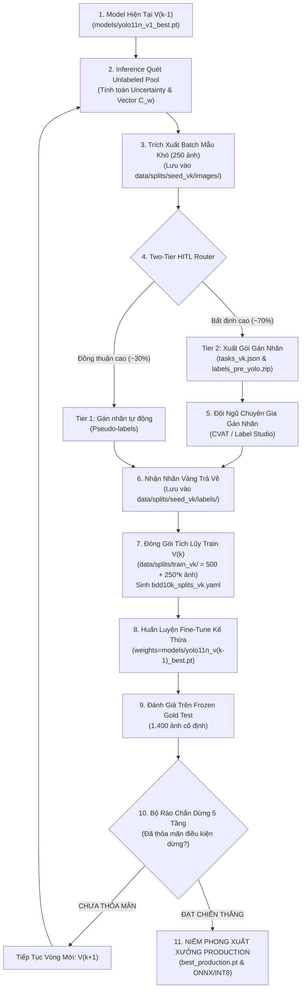

# 🔄 CẨM NANG VẬN HÀNH VÒNG LẶP LIÊN TỤC TRÊN PRODUCTION (CONTINUOUS ACTIVE HITL RUNBOOK)
*(Hướng dẫn chi tiết: Trích xuất tập mẫu khó ➔ Xuất file gửi gán nhãn ➔ Nạp nhãn về chạy V2/Vk ➔ Tiêu chí dừng vòng lặp)*

> [!IMPORTANT]
> **Mục tiêu của Cẩm nang**: Hướng dẫn kỹ sư MLOps và Tech Lead từng bước cụ thể bằng dòng lệnh, cấu trúc file và đường dẫn thư mục để vận hành quy trình Active Learning & Human-in-the-Loop trên môi trường thực tế từ Vòng 1 ($V_1$), Vòng 2 ($V_2$) đến khi đạt điều kiện dừng hoàn hảo.

---

## 🗺️ 1. Sơ Đồ Toàn Cảnh Vòng Lặp Production ($V_{k-1} \rightarrow V_k$)



---

## 📦 2. Mỗi Lần Khai Thác Mẫu Thì Lưu Ở Đâu? (Storage Layout)

Khi hệ thống kích hoạt giải thuật **C6 Super-Fusion**, các ảnh được lựa chọn sẽ được tổ chức độc lập và minh bạch theo từng vòng lặp:

### 2.1. Vị Trí Lưu Ảnh & Manifest Của Vòng $k$
| Thành phần | Đường dẫn thực tế trong dự án | Vai trò kỹ thuật |
| :--- | :--- | :--- |
| **Thư mục ảnh chọn mới** | [`data/splits/seed_v{k}/images/`](file:///Users/huynh/orca/workspaces/BuildPhase/tang/data/splits/) | Chứa các symlink trỏ tới đúng 250 ảnh thách thức nhất của vòng $k$. |
| **Thư mục nhãn mới** | [`data/splits/seed_v{k}/labels/`](file:///Users/huynh/orca/workspaces/BuildPhase/tang/data/splits/) | Nơi nạp các file `.txt` nhãn sau khi gán nhãn xong. |
| **Manifest chi tiết vòng $k$** | [`data/splits/manifest_v{k}.yaml`](file:///Users/huynh/orca/workspaces/BuildPhase/tang/data/splits/) | Liệt kê danh sách ảnh, điểm Uncertainty, tag lát cắt, SHA-256. |
| **Báo cáo phân luồng HITL** | [`results/phase_05/hitl_routing_report.json`](file:///Users/huynh/orca/workspaces/BuildPhase/tang/results/phase_05/) | Thống kê số lượng Tier 1 (máy tự duyệt) và Tier 2 (gửi người). |

---

## 📤 3. Gửi Đi Gán Nhãn Thì Xuất Ra File Gì? (Labeling Export Formats)

Hệ thống cung cấp cơ chế đóng gói tự động thành 3 định dạng tương thích với mọi nền tảng gán nhãn công nghiệp (**CVAT**, **Label Studio**, **Labelbox**, **Scale AI**):

### 3.1. File 1: Danh Sách Tác Vụ (`tasks_manifest_v{k}.json`)
File JSON đặc tả danh sách ảnh và mức độ ưu tiên để nạp vào công cụ quản lý tác vụ:
```json
{
  "project": "BDD10K_Autonomous_Driving_HITL",
  "iteration": 2,
  "batch_size": 250,
  "target_rare_classes": ["motor", "rider", "train", "bus", "truck"],
  "tasks": [
    {
      "image_id": "0d32f867-4b7443ad",
      "file_path": "data/splits/seed_v2/images/0d32f867-4b7443ad.jpg",
      "priority_score": 0.942,
      "challenge_tags": ["night", "heavy_occlusion", "small_objects"],
      "recommended_tier": "tier_2_human_expert"
    }
  ]
}
```

### 3.2. File 2: Gói Pre-Annotations Gợi Ý Sẵn (`pre_annotations_v{k}.zip`)
> [!TIP]
> **Bí quyết tăng tốc độ gán nhãn gấp 3 đến 5 lần**: Không bắt người gán nhãn vẽ bounding box từ đầu! Hệ thống xuất sẵn các file `.txt` (YOLO format) hoặc `annotations.json` (COCO format) chứa dự đoán sơ bộ của Model $V_{k-1}$. Người gán nhãn chỉ việc mở ra, kiểm tra và chỉnh sửa nhanh những box bị lệch.

### 3.3. Lệnh CLI Xuất Gói Gán Nhãn:
```bash
PYTHONPATH=. .venv/bin/python scripts/export_labeling_package.py \
    --iteration 2 \
    --format cvat_yolo \
    --output reports/labeling_batches/batch_v2.zip
```

---

## 📥 4. Nạp Nhãn Về Để Huấn Luyện Model $V_2$ (Step-by-Step Training $V_2$)

Khi đội ngũ chuyên gia gán nhãn hoàn thành và bấm **Export** từ giao diện CVAT/Label Studio, bạn tiến hành nạp nhãn về và kích hoạt chu trình huấn luyện tiếp sức:

### Bước 4.1: Đặt File Nhãn Về Đúng Thư Mục
Giải nén các file nhãn `.txt` vào thư mục nhãn của vòng tương ứng:
```bash
# Đặt các file txt nhãn vào thư mục nhãn của đợt V2
cp -r /path/to/exported_labels/*.txt data/splits/seed_v2/labels/
```

### Bước 4.2: Đóng Gói Tích Lũy Tập Huấn Luyện `train_v2`
Chạy lệnh đóng gói tập dữ liệu tích lũy (500 ảnh $V_0$ + 250 ảnh $V_1$ + 250 ảnh $V_2$ = 1.000 ảnh):
```bash
PYTHONPATH=. .venv/bin/python scripts/package_active_dataset.py --iteration 2
```
*Lệnh này sẽ tự động:*
- Gộp các symlinks ảnh và labels vào [`data/splits/train_v2/`](file:///Users/huynh/orca/workspaces/BuildPhase/tang/data/splits/).
- Trừ 250 ảnh đã chọn ra khỏi `data/splits/unlabeled_pool/` để không bao giờ bốc trùng.
- Tự động sinh file cấu hình YOLO [`data/splits/bdd10k_splits_v2.yaml`](file:///Users/huynh/orca/workspaces/BuildPhase/tang/data/splits/):
```yaml
path: /Users/huynh/orca/workspaces/BuildPhase/tang/data/splits
train: train_v2/images
val: fixed_val/images
test: fixed_test/images
names: {0: person, 1: rider, 2: car, 3: truck, 4: bus, 5: train, 6: motor, 7: bike, 8: traffic light, 9: traffic sign}
```

### Bước 4.3: Huấn Luyện Fine-Tune Kế Thừa Checkpoint $V_1$
Chạy lệnh huấn luyện với công thức Quán quân **Cfg-3 Proposed Recipe** (AdamW + Cosine Annealing LR):
```bash
PYTHONPATH=. .venv/bin/python scripts/run_phase_06_model_v1_training.py \
    --weights models/yolo11n_v1_best.pt \
    --data data/splits/bdd10k_splits_v2.yaml \
    --epochs 15 \
    --iteration 2 \
    --output models/yolo11n_v2_best.pt
```

---

## 🛑 5. Khi Nào Dùng Thì Thôi? (5-Tier Stopping Criteria)

Trên Production, việc huấn luyện và gán nhãn KHÔNG chạy vô tận mà được bảo vệ bởi **Bộ Rào Chắn Dừng 5 Tầng (5-Tier Stopping Gates)** tích hợp trong [`src/autonomous_loop.py`](file:///Users/huynh/orca/workspaces/BuildPhase/tang/src/autonomous_loop.py):

| Rào Chắn Dừng | Điều Kiện Kích Hoạt | Ý Nghĩa Kỹ Thuật & Hành Động |
| :--- | :--- | :--- |
| **1. Target Ceiling Gate** *(Chiến Thắng)* | $mAP_{50} \ge 26.85\%$ *(Vượt trần 100% dữ liệu)* | Kích hoạt thêm 1 vòng xác nhận ($k+1$). Nếu tiếp tục duy trì $\rightarrow$ Tuyên bố `VICTORY_CONFIRMED`, **DỪNG VÒNG LẶP NGAY LẬP TỨC**. |
| **2. Target Plateau Gate** *(Bão Hòa Trần)* | $mAP_{50} \ge 95\% \times Target$ VÀ $\Delta mAP < 0.3\%$ | Đã đạt sát trần hiệu năng nhưng không tăng trưởng thêm. **Dừng gán nhãn để tiết kiệm chi phí**. |
| **3. Knowledge Saturation** *(Bão Hòa Tri Thức)* | $\Delta mAP < 0.3\%$ liên tiếp qua 2 vòng | Mô hình không còn hấp thụ thêm tri thức mới từ dữ liệu bổ sung. **Dừng vòng lặp**. |
| **4. Uncertainty Depleted** *(Cạn Kiệt Mẫu Khó)* | Điểm $\text{Top-K Uncertainty} < 0.15$ | Kho dữ liệu chưa gán nhãn đã hết các trường hợp thách thức. **Dừng khai thác**. |
| **5. Survival Budget Limit** *(Trần Ngân Sách)* | Số lượng ảnh đã gán nhãn chạm $80\%$ pool | Hết hạn mức ngân sách dự án. **Dừng bắt buộc**. |

---

## 🚀 6. Đóng Gói Xuất Xưởng Bản Production Cuối Cùng

Khi một trong các điều kiện dừng ở Mục 5 được kích hoạt, kỹ sư tiến hành niêm phong và xuất xưởng mô hình phục vụ thực tế:

```bash
# 1. Niêm phong checkpoint chính thức
cp models/yolo11n_v5_best.pt models/best_production.pt

# 2. Xuất xưởng format ONNX FP16 cho máy chủ Inference
.venv/bin/python -c "
from ultralytics import YOLO
m = YOLO('models/best_production.pt')
m.export(format='onnx', half=True, dynamic=True)
print('✓ Đã xuất xưởng models/best_production.onnx')
"

# 3. Xuất xưởng format OpenVINO INT8 cho chip nhúng trên xe
.venv/bin/python -c "
from ultralytics import YOLO
m = YOLO('models/best_production.pt')
m.export(format='openvino', int8=True, data='data/splits/bdd10k_splits_v1.yaml')
print('✓ Đã xuất xưởng OpenVINO INT8 (<8ms/ảnh trên CPU nhúng)!')
"
```
