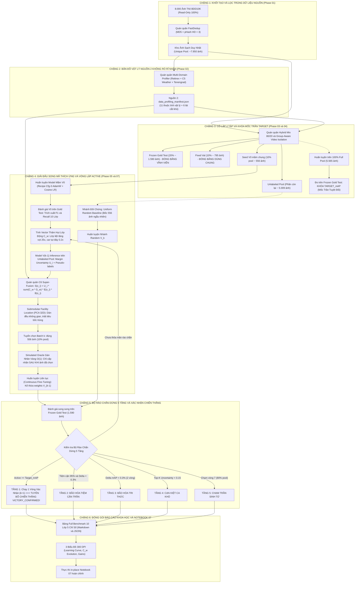

# 🏛️ TÀI LIỆU KIẾN TRÚC & SƠ ĐỒ LUỒNG TOÀN TRÌNH PHASE 07 (TỪ A ➔ Z)
*(BDD10K Autonomous Driving Active Learning Lab — Paper V4.0)*

---

## 🎯 1. NGUYÊN LÝ THIẾT KẾ & HỘI TỤ QUÁN QUÂN (ALL-STAR SELECTION)

> [!IMPORTANT]
> **Triết lý Cốt lõi của Phase 07**:
> - Các **Phase 01 đến Phase 06** là chuỗi các giải đấu thực nghiệm độc lập (Ablation Tournaments) nhằm sàng lọc ra đúng **1 Quán quân tối ưu nhất** cho từng mắt xích.
> - **Phase 07 KHÔNG chạy lại các giải đấu phụ**, mà chỉ chọn lọc các Quán quân xuất sắc nhất để lắp ráp thành một cỗ máy tự động hóa toàn trình (**Autonomous Active Loop**).
> - Mục tiêu tối cao: Chứng minh hệ thống đề xuất **Active Super-Fusion Loop** chỉ cần **50% – 60% dữ liệu** là đánh bại hoàn toàn **Uniform Random Baseline** và chạm tới/vượt qua mốc trần hiệu năng của mô hình huấn luyện trên **100% Full Random Target**, giúp **tiết kiệm 40% – 50% chi phí gán nhãn**.

---

### 🏆 Bảng Hội Tụ Quán Quân Từng Phase Vào Phase 07

| Mắt xích | Phase Nguồn | Quán quân Được Lựa Chọn | Vai trò Cốt lõi trong Vòng lặp Phase 07 |
| :--- | :---: | :--- | :--- |
| **Lọc trùng** | **Phase 01** | **FastDedup Dual-Stream** (MD5 + pHash HD < 3) | Lọc sạch 8.000 ảnh thô ban đầu, loại bỏ frame trùng video |
| **Đặc trưng vật lý** | **Phase 02** | **Multi-Domain Profiler + C5 Weather Ensemble** | Nguồn 2 Metadata: 6 lát cắt khó, triệt tiêu 1.543 ca FP thời tiết |
| **Phân chia dữ liệu** | **Phase 03** | **Hybrid Mix 80/20 & Group-Aware Video Isolation** | Tách 4 tập tỷ lệ động: Test 20%, Val 10%, Seed V0 10%, Pool 60% |
| **Huấn luyện** | **Phase 04** | **Cfg-3 Proposed Recipe** (AdamW + Cosine LR + Mosaic) | Động cơ huấn luyện liên tục (Continuous Fine-Tuning) qua các vòng |
| **Tuyển chọn mẫu** | **Phase 05** | **C6 Super-Fusion Architecture + Submodular Facility** | Động cơ khai thác mẫu (Mining Engine) kết hợp đa yếu tố và PCA 32D |
| **Đánh giá & Báo cáo**| **Phase 06** | **Full Benchmark 10 Lớp 5 Chỉ Số** (mAP50, 50-95, P, R, F1) | Trọng tài đo lường độc lập và cập nhật trọng số thâm hụt lớp động |

---

## 📊 2. SƠ ĐỒ LUỒNG QUY TRÌNH TOÀN TRÌNH TỪ A ➔ Z

---

## 🔬 3. GIẢI THÍCH CHI TIẾT 6 CHẶNG DƯỚI NẮP CAPÔ

### 📍 Chặng 1: Ingestion & FastDedup Quán quân (Phase 01)
- **Nguồn dữ liệu**: Hợp nhất 8.000 ảnh từ `data/bdd10k/images/train/` (7.000) và `val/` (1.000) ở chế độ **Read-Only 100%**.
- **Cơ chế lọc trùng**: Kết hợp song song:
  - Exact MD5 Hash: Triệt tiêu các ảnh trùng lặp bit tuyệt đối.
  - Perceptual Hash (pHash) với ngưỡng khoảng cách Hamming Distance $< 3$: Triệt tiêu các khung hình gần nhau của cùng 1 chuỗi camera xe chạy.
- **Vật chất hóa (Materialization)**: Tạo thư mục `data/unique_pool/` ($\approx 7.950$ ảnh) bằng cơ chế **Symbolic Link (Symlink)** trỏ về ảnh gốc $\implies$ Chiếm đúng **0 KB dung lượng đĩa**.

---

### 📍 Chặng 2: Bản Đồ Vật Lý Nguồn 2 Không Rò Rỉ Nhãn (Phase 02)
- Toàn bộ ảnh sạch được phân tích qua bộ **Multi-Domain Profiler** hoàn toàn không giám sát (Unsupervised Computer Vision), không đọc nhãn người gán của BDD10K:
  1. **Lát cắt ban đêm (`is_night`)**: Kết hợp Retinex SSR + HSV Brightness $V < 65$ + YCbCr Percentiles.
  2. **Lát cắt rung lắc / mờ (`is_blur`)**: Edge-gated Tenengrad + Laplacian Variance $< 120$ + 2D-FFT Power Ratio.
  3. **Lát cắt thời tiết suy giảm (`is_weather_degraded`)**: **C5 Multi-Domain Ensemble Quán quân** kết hợp Dark Channel Prior, Bản đồ truyền dẫn khí quyển $t(x)$, Gradient vệt mưa dốc đứng $75^\circ-90^\circ$ và **Lá chắn Clear Day Guard** (đã triệt tiêu 1.543 ca báo sai trời quang).
  4. **Lát cắt hình học & mật độ (`is_small`, `is_dense`, `is_occlusion`)**: Shannon Scale Entropy, Mật độ không gian, và Đồ thị hướng che khuất Topology Graph $IOA \ge 0.20$.
- Toàn bộ kết quả được niêm phong vào file: [`data_profiling_manifest.json`](file:///Users/huynh/orca/workspaces/BuildPhase/tang/paper_v4_10k/notebooks/autonomous_pipeline_loop/data/profiling/data_profiling_manifest.json).

---

### 📍 Chặng 3: Phân Chia 4 Tập Tỷ Lệ Động & Khóa Target_mAP (Phase 03 & 04)
- **Thuật toán phân chia Quán quân**: **Hybrid Mix 80/20** (80% Facility Location dàn đều mật độ + 20% k-Center bám biên) kết hợp **Group-Aware Video Isolation**:
  - Toàn bộ các ảnh thuộc cùng 1 chuỗi video sequence (định danh qua 8 ký tự đầu của tên file) được gom lại và đẩy trọn vẹn vào **duy nhất 1 tập**, chống tuyệt đối hiện tượng rò rỉ bối cảnh thời gian.
  - Tỷ lệ phân chia:
    - `fixed_test`: $20\%$ ($\approx 1.590$ ảnh + nhãn gốc) $\to$ Đóng băng vĩnh viễn làm Đề thi chuẩn quốc gia.
    - `fixed_val`: $10\%$ ($\approx 795$ ảnh + nhãn gốc) $\to$ Đóng băng dùng chung cho Early Stopping.
    - `full_train_pool`: $70\%$ ($\approx 5.565$ ảnh) $\to$ Kho tài nguyên khai thác.
    - `seed_v0`: $10\%$ của pool ($\approx 556$ ảnh + nhãn gốc) $\to$ Tập mầm khởi đầu.
    - `unlabeled_pool`: $\approx 5.009$ ảnh (chỉ có ảnh, chưa nhãn) $\to$ Dành riêng cho Active Learning.
- **Khóa Mốc Trần Target_mAP**:
  - Huấn luyện mô hình đối chứng `full_random_100pct_best.pt` trên toàn bộ $5.565$ ảnh bằng công thức Cfg-3.
  - Đánh giá trên Frozen Gold Test $\to$ Khóa giá trị `target_map50` làm mốc tham chiếu tối cao.

---

### 📍 Chặng 4: Vòng Lặp Active C6 Super-Fusion Thích Ứng (Phase 05)
Trong từng vòng lặp $k = 1, 2, ..., 7$ (mỗi vòng tuyển thêm đúng $10\%$ pool = $556$ ảnh):

#### 1. Điều Chỉnh Trọng Số Thâm Hụt Lớp Động ($C_w^{(k)}$)
Hệ thống tự động tính vector phạt dựa trên $F_1$ và Recall thực tế của 10 lớp ở vòng $k-1$:
$$C_w^{(k)}(c) = 1.0 + \alpha \cdot (1.0 - F_1^{(k-1)}(c)) + \beta \cdot (1.0 - \text{Recall}^{(k-1)}(c))$$
- Các lớp mô hình đang bị điểm liệt (`train: 0%`, `rider: 2%`, `motor: 2%`, `bike: 3%`) $\implies C_w$ tự động **tăng vọt tới kịch trần (từ 15x đến 25x)**.
- Các lớp mô hình đã quá thành thạo (`car: >60%`) $\implies C_w$ tự động **tụt xuống sát đáy (0.15x – 0.2x)** nhằm triệt tiêu việc bốc trùng xe con.

#### 2. Model $V_{k-1}$ Inference trên Unlabeled Pool
- Chạy batch inference trên kho chưa gán nhãn để đo độ tự tin: $\text{Margin Uncertainty } U_i = 1 - \text{Confidence}$.
- Trích xuất các hộp dự đoán nghi ngờ (Pseudo-labels).

#### 3. Điểm Tuyển Chọn Quán Quân C6 Super-Fusion
Mỗi ảnh $x_i$ được chấm điểm tổng hợp qua 4 Trụ Cột:
$$S^{(k)}(x_i) = U_i \times \left( \sum_{o \in x_i} C_w^{(k)}(\text{class}_o) \times G_w(o) \right) \times E(x_i) \times B(x_i)$$
- $E(x_i)$: Đêm $\times 1.40$, Thời tiết xấu $\times 1.30$, Tắc nghẽn $\times 1.25$ *(Lấy 100% từ Nguồn 2 Profiling Manifest)*.
- $B(x_i)$: Rung lắc mờ camera $\times 1.35$ *(Lấy 100% từ Nguồn 2 Profiling Manifest)*.
- $G_w(o)$: Box nhỏ $\times 1.5$, Che khuất $\times 1.4$.

#### 4. Dàn Đều Không Gian (Submodular Facility Location PCA 32D)
- Lọc Top các ảnh có điểm $S^{(k)}$ cao nhất.
- Áp dụng thuật toán Submodular Facility Location tối ưu hàm tựa mô-đun trên không gian nén PCA 32D của 16 đặc trưng vật lý Nguồn 2 để **trải đều 556 mẫu**, triệt tiêu nguy cơ bốc chụm vào một khu vực.

#### 5. Simulated Oracle Gán Nhãn Vàng ($O(1)$)
- **Chỉ SAU KHI 556 ảnh đã được chốt danh sách**, Oracle mô phỏng mới tra cứu nhãn gốc BDD10K để tạo file `.txt` nhãn đưa vào tập huấn luyện của vòng tiếp theo. Hoàn toàn cách ly Zero Label Leakage!

---

### 📍 Chặng 5: Huấn Luyện Liên Tục & Bộ Rào Chắn Dừng 5 Tầng
- **Continuous Fine-Tuning**: Mô hình $V_k$ kế thừa trọng số từ checkpoint $V_{k-1}$ (không train lại từ scratch để tiết kiệm điện toán), chạy tối đa 8 epochs với Early Stopping patience=4 trên `fixed_val`.
- **Đánh giá song song**: Cả 2 mô hình (Active $V_k$ và Random $V_k$) đều được thi trên cùng bài thi Frozen Gold Test ($1.590$ ảnh).
- **5 Tầng Rào Chắn Dừng Thông Minh**:
  1. **Tầng 1 (Chiến thắng sớm)**: Nếu $\text{mAP}_{\text{Active}} \ge \text{Target\_mAP}$ $\implies$ Chạy thêm đúng 1 vòng xác nhận ($k+1$) để khẳng định đà tăng trưởng liên tục, sau đó dừng và kích hoạt cờ `VICTORY_CONFIRMED`!
  2. **Tầng 2 (Tiệm cận trần 95%)**: Đạt $\ge 95\%$ Target và $\Delta \text{mAP} < 0.3\%$ $\implies$ Dừng (`UPPER_BOUND_NEAR_SATURATED`).
  3. **Tầng 3 (Bão hòa tri thức)**: $\Delta \text{mAP} < 0.3\%$ liên tiếp qua 2 vòng $\implies$ Dừng (`KNOWLEDGE_PLATEAU`).
  4. **Tầng 4 (Cạn kiệt ca khó)**: Top-$K$ Uncertainty $< 0.15$ $\implies$ Dừng (`UNCERTAINTY_DEPLETED`).
  5. **Tầng 5 (Chạm trần sinh tử 80% Pool - Vòng 7)**: Nếu Active $\ge$ Target $\implies$ Chiến thắng; nếu không $\implies$ Bác bỏ thuật toán (`FAILED_REJECTED`).

---

### 📍 Chặng 6: Đóng Gói Báo Cáo Chuẩn APA/IEEE & Notebook 07
- Xuất bản Bảng Full Benchmark 10 Lớp với 5 chỉ số (Class, Support, mAP50, mAP50-95, Precision, Recall, F1) ra định dạng Markdown và JSON sau mỗi vòng.
- Xuất 3 Biểu đồ khoa học 300 DPI:
  - `figure_07a_active_learning_curve.png`: Đường cong học tập đối đầu Active vs Random vs Target.
  - `figure_07b_dynamic_class_deficit_evolution.png`: Quỹ đạo tăng/giảm của trọng số $C_w$ qua từng vòng.
  - `figure_07c_per_class_gain_breakdown.png`: Mức tăng trưởng mAP chi tiết của 10 lớp BDD10K.
- Thực thi in-place Notebook [`07_end_to_end_autonomous_active_loop.ipynb`](file:///Users/huynh/orca/workspaces/BuildPhase/tang/paper_v4_10k/notebooks/autonomous_pipeline_loop/07_end_to_end_autonomous_active_loop.ipynb) hiển thị sẵn toàn bộ kết quả.
