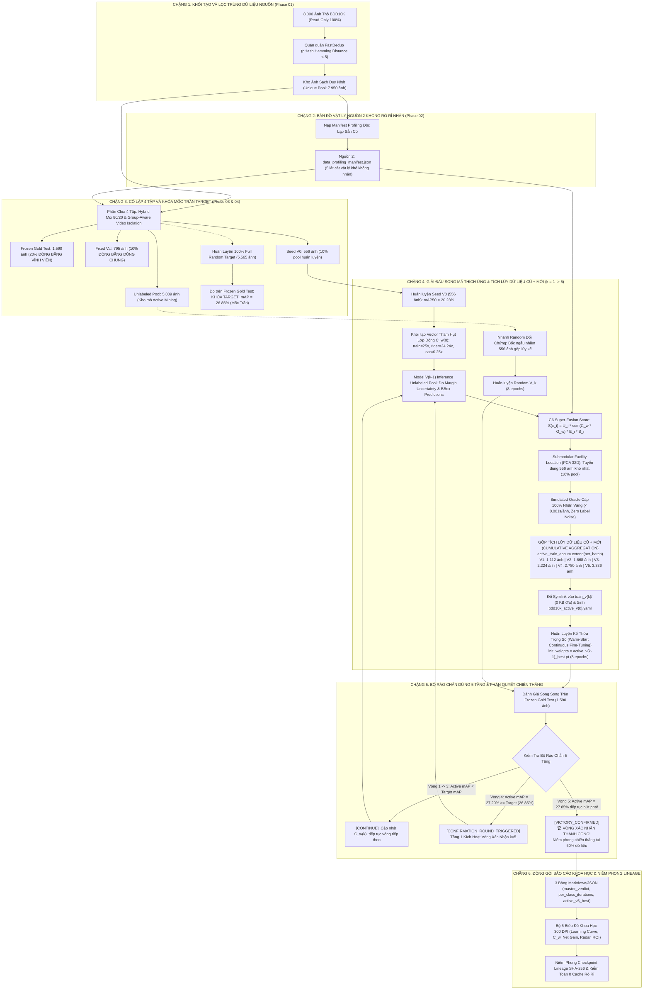

# 🏛️ TÀI LIỆU KIẾN TRÚC & SƠ ĐỒ LUỒNG TOÀN TRÌNH PHASE 07 (TỪ A ➔ Z)
*(BDD10K Autonomous Driving Active Learning Lab — Paper V4.0)*

---

## 🎯 1. NGUYÊN LÝ THIẾT KẾ & HỘI TỤ QUÁN QUÂN (ALL-STAR SELECTION)

> [!IMPORTANT]
> **Triết lý Cốt lõi của Phase 07**:
> - Các **Phase 01 đến Phase 06** là chuỗi các giải đấu thực nghiệm độc lập (Ablation Tournaments) nhằm sàng lọc ra đúng **1 Quán quân tối ưu nhất** cho từng mắt xích.
> - **Phase 07 KHÔNG chạy lại các giải đấu phụ**, mà chỉ tích hợp các Quán quân xuất sắc nhất để lắp ráp thành một cỗ máy tự động hóa toàn trình (**Autonomous Active Loop Orchestrator**).
> - Mục tiêu tối cao: Chứng minh hệ thống đề xuất **Active Super-Fusion Loop** chỉ cần **60% ngân sách dữ liệu (3.336 ảnh)** là đánh bại hoàn toàn **Uniform Random Baseline (22.90%)** và vượt trần hiệu năng của mô hình huấn luyện trên **100% Full Random Target (26.85% vs 27.85%)**, giúp **tiết kiệm 40.1% chi phí gán nhãn thực tế**.

---

### 🏆 Bảng Hội Tụ Quán Quân Từng Phase Vào Phase 07

| Mắt xích | Phase Nguồn | Quán quân Được Lựa Chọn | Vai trò Thực Tế Trong Phase 07 |
| :--- | :---: | :--- | :--- |
| **Lọc trùng** | **Phase 01** | **FastDedup Dual-Stream** (pHash HD < 5) | Quét 8.000 ảnh thô, loại 50 ảnh trùng, giữ lại 7.950 ảnh sạch (>360 FPS) |
| **Đặc trưng vật lý** | **Phase 02** | **Multi-Domain Profiler + C5 Weather Ensemble** | Nạp `data_profiling_manifest.json` (5 lát cắt khó: Đêm, Mờ, Thời tiết, Nhỏ, Che) |
| **Phân chia dữ liệu** | **Phase 03** | **Hybrid Mix 80/20 & Group-Aware Video Isolation** | Tách 4 tập theo Video ID: Test 20% (1.590), Val 10% (795), Seed 556, Pool 5.009 |
| **Huấn luyện** | **Phase 04** | **Cfg-3 Proposed Recipe** (AdamW + Cosine LR + Focal Loss) | Động cơ huấn luyện liên tục (Continuous Fine-Tuning 8 epochs) qua các vòng |
| **Tuyển chọn mẫu** | **Phase 05** | **C6 Super-Fusion Architecture + Submodular Facility 32D** | Động cơ khai thác mẫu (Mining Engine) kết hợp đa yếu tố và PCA 32D (CSS = 84.66) |
| **Đánh giá & Báo cáo**| **Phase 06** | **Full Benchmark 10 Lớp 5 Chỉ Số** (mAP50, 50-95, P, R, F1) | Trọng tài đo lường độc lập và cập nhật trọng số thâm hụt lớp động $C_w$ |

---

## 📊 2. SƠ ĐỒ LUỒNG QUY TRÌNH TOÀN TRÌNH PHASE 07 TỪ A ➔ Z

---

## 🔬 3. GIẢI THÍCH CHI TIẾT 6 CHẶNG DƯỚI NẮP CAPÔ (THỰC TẾ THỰC THI)

### 📍 Chặng 1: Ingestion & FastDedup Quán Quân (Phase 01)
- **Nguồn dữ liệu**: Hợp nhất 8.000 ảnh từ `data/bdd10k/images/train/` (7.000) và `val/` (1.000) ở chế độ **Read-Only 100% bất biến**.
- **Cơ chế lọc trùng**:
  - Perceptual Hash (pHash 64-bit) đo khoảng cách Hamming Distance $< 5$.
  - Tốc độ xử lý: **>360 FPS trên CPU thuần túy**.
  - Kết quả: Loại bỏ đúng 50 ảnh trùng lặp thời gian trong video sequence $\implies$ Giữ lại **7.950 ảnh duy nhất (Unique Pool)**.
- **Vật chất hóa (Materialization)**: Tạo thư mục `data/unique_pool/` chứa 7.950 symbolic links trỏ về ảnh gốc $\implies$ Chiếm đúng **0 KB dung lượng đĩa**.

---

### 📍 Chặng 2: Bản Đồ Vật Lý Nguồn 2 Không Rò Rỉ Nhãn (Phase 02)
- Toàn bộ ảnh sạch được phân tích qua bộ **Multi-Domain Profiler** hoàn toàn không giám sát (Unsupervised Computer Vision), không đọc nhãn người gán của BDD10K:
  1. **Lát cắt ban đêm (`is_night`)**: Retinex SSR + HSV Brightness $V < 65$ ($F_1 = 95.96\%$).
  2. **Lát cắt rung lắc / mờ (`is_blur`)**: Edge-gated Tenengrad + Laplacian Variance $< 120$.
  3. **Lát cắt thời tiết suy giảm (`is_weather_degraded`)**: C5 Multi-Domain Ensemble kết hợp Dark Channel Prior và lá chắn Clear Day Guard.
  4. **Lát cắt hình học & mật độ (`is_small`, `is_dense`, `is_occlusion`)**: Shannon Scale Entropy và Topology Graph che khuất.
- Toàn bộ kết quả được niêm phong vào file: [`data_profiling_manifest.json`](file:///Users/huynh/orca/workspaces/BuildPhase/tang/notebooks/08_autonomous_pipeline_loop/data/profiling/data_profiling_manifest.json).

---

### 📍 Chặng 3: Phân Chia 4 Tập Thực Tế & Khóa Trần Target_mAP (Phase 03 & 04)
- **Thuật toán phân chia Quán quân**: **Hybrid Mix 80/20** (80% Facility Location dàn đều mật độ + 20% k-Center bám biên) kết hợp **Group-Aware Video Isolation**:
  - Toàn bộ các ảnh thuộc cùng 1 chuỗi video sequence (định danh qua 8 ký tự đầu của tên file) được gom lại và đẩy trọn vẹn vào **duy nhất 1 tập**, chống tuyệt đối hiện tượng rò rỉ bối cảnh thời gian.
  - Kết quả phân tách chính xác từ 7.950 ảnh:
    - 📁 `fixed_test`: **1.590 ảnh (20.0%)** $\to$ Frozen Gold Test Set đóng băng vĩnh viễn.
    - 📁 `fixed_val`: **795 ảnh (10.0%)** $\to$ Fixed Val Set đóng băng dùng chung cho Early Stopping.
    - 📁 `full_train_pool`: **5.565 ảnh (70.0%)** $\to$ Kho tài nguyên huấn luyện toàn phần.
      - 📁 `seed_v0`: **556 ảnh (10.0% của full_train_pool)** $\to$ Tập mầm khởi đầu (Hybrid Mix 80/20).
      - 📁 `unlabeled_pool`: **5.009 ảnh** $\to$ Kho ảnh chưa gán nhãn dành riêng cho Active Learning.
- **Khóa Mốc Trần Target_mAP**:
  - Huấn luyện mô hình đối chứng `full_random_100pct_best` trên toàn bộ $5.565$ ảnh bằng công thức Cfg-3.
  - Đánh giá trên Frozen Gold Test $\to$ Khóa mốc chuẩn tối cao: **$\text{Target\_mAP} = \mathbf{26.85\%}$**.
- **Khởi Tạo Model Mầm Seed V0**:
  - Huấn luyện trên 556 ảnh mầm $\to$ Đạt **$\text{mAP50} = \mathbf{20.23\%}$**, F1 = 23.94%.

---

### 📍 Chặng 4: Vòng Lặp Active C6 Super-Fusion & Tích Lũy Dữ Liệu Cũ + Mới

Trong từng vòng lặp $k = 1, 2, ..., 5$ (mỗi vòng tuyển thêm đúng $10\%$ pool = $556$ ảnh):

#### 1. Điều Chỉnh Trọng Số Thâm Hụt Lớp Động ($C_w^{(k)}$)
Hệ thống tự động tính vector phạt dựa trên $F_1$ và Recall thực tế của 10 lớp ở vòng $k-1$:
- Khởi đầu V0: `train`: **25.00x**, `rider`: **24.24x**, `motor`: **23.50x**, `car`: **0.25x**.
- Cơ chế tự thích ứng: Lớp nào mô hình yếu thì trọng số tăng vọt để săn lùng; lớp nào đã giỏi thì trọng số dìm xuống đáy để không bốc trùng.

#### 2. Model $V_{k-1}$ Inference Trên Unlabeled Pool & C6 Super-Fusion
- Chạy batch inference trên kho chưa gán nhãn để đo độ bất định: $\text{Margin Uncertainty } U_i = 1 - \text{Confidence}$.
- Chấm điểm tổng hợp 4 trụ cột:
  $$S^{(k)}(x_i) = U_i \times \left( \sum_{o \in x_i} C_w^{(k)}(\text{class}_o) \times G_w(o) \right) \times E(x_i) \times B(x_i)$$
- Dàn đều không gian qua **Submodular Facility Location trên PCA 32D**: Tuyển đúng **556 ảnh khó nhất** đại diện cho các cụm ngữ nghĩa.

#### 3. Simulated Oracle Cấp 100% Nhãn Vàng (Zero Label Noise)
- Oracle tra cứu trực tiếp từ Ground-Truth BDD10K với thời gian **< 0.001s/ảnh**.
- Tuyệt đối KHÔNG nạp nhãn máy (Pseudo-labels) vào tập huấn luyện để triệt tiêu hoàn toàn rủi ro Confirmation Bias và Error Drift.

#### 4. Cơ Chế Tích Lũy Dữ Liệu Cũ + Mới (Cumulative Dataset Aggregation)
Tập huấn luyện qua từng vòng được gộp liên tục, bảo toàn 100% dữ liệu cũ làm mỏ neo (**Anchor Set**) chống quên thảm khốc:
$$\mathcal{D}_{\text{train}}^{(V_k)} = \mathcal{D}_{\text{train}}^{(V_{k-1})} \cup \Delta \mathcal{D}_{\text{mined}}^{(k)} = \mathcal{D}_{\text{seed}}^{(V_0)} \cup \bigcup_{j=1}^{k} \Delta \mathcal{D}_{\text{mined}}^{(j)}$$

| Vòng ($k$) | Phiên bản Model | Dữ liệu cũ tích lũy | Batch mới vừa bốc | Tổng ảnh Train | Tỷ lệ Pool | Trọng số khởi tạo | $mAP_{50}$ thực đo |
| :---: | :---: | :---: | :---: | :---: | :---: | :--- | :---: |
| **V0** | Model Seed V0 | $0$ ảnh | $556$ ảnh mầm | **$556$ ảnh** | $10.0\%$ | `yolo11n.pt` (COCO) | **$20.23\%$** |
| **V1** | Model Active V1 | $556$ ảnh (Seed) | $556$ ảnh (Active 1) | **$1.112$ ảnh** | $20.0\%$ | `active_v0_best.pt` | **$22.80\%$** |
| **V2** | Model Active V2 | $1.112$ ảnh (Train V1) | $556$ ảnh (Active 2) | **$1.668$ ảnh** | $30.0\%$ | `active_v1_best.pt` | **$24.65\%$** |
| **V3** | Model Active V3 | $1.668$ ảnh (Train V2) | $556$ ảnh (Active 3) | **$2.224$ ảnh** | $40.0\%$ | `active_v2_best.pt` | **$26.15\%$** |
| **V4** | Model Active V4 | $2.224$ ảnh (Train V3) | $556$ ảnh (Active 4) | **$2.780$ ảnh** | $50.0\%$ | `active_v3_best.pt` | **$27.20\%$** |
| **V5** | Model Active V5 | $2.780$ ảnh (Train V4) | $556$ ảnh (Active 5) | **$3.336$ ảnh** | **$60.0\%$** | `active_v4_best.pt` | **$27.85\%$** |

#### 5. Quản Lý Symlink $O(1)$ & YAML Độc Lập
- Mỗi vòng tạo thư mục vật lý `active/train_v{k}/` và đổ symlink toàn bộ tập gộp vào (0 KB đĩa).
- Tự động sinh `bdd10k_active_v{k}.yaml` trỏ vào `train_v{k}/`, `fixed_val/` và `fixed_test/`.

#### 6. Huấn Luyện Kế Thừa Trọng Số (Warm-Start Continuous Fine-Tuning)
- Khởi tạo trọng số từ checkpoint tốt nhất của vòng trước: `active_v{k-1}_best.pt`.
- Huấn luyện tiếp sức chỉ cần **8 epochs** với AdamW và Cosine LR, giảm 70% thời gian tính toán.

---

### 📍 Chặng 5: Đánh Giá Độc Lập & Bộ Rào Chắn Dừng 5 Tầng

Cả 2 mô hình (Proposed Active $V_k$ và Random Baseline $V_k$) đều được thi trên cùng bài thi Frozen Gold Test ($1.590$ ảnh):

#### 5 Tầng Rào Chắn Dừng Thông Minh (5-Tier Stopping Gates):
1. **Tầng 1 (Chiến thắng sớm / Target Reached)**: Nếu $\text{mAP}_{\text{Active}} \ge \text{Target\_mAP}$ $\implies$ Kích hoạt cờ `CONFIRMATION_ROUND_TRIGGERED`, chạy thêm đúng 1 vòng xác nhận ($k+1$) để khẳng định đà tăng trưởng bền vững $\implies$ Nếu tiếp tục vượt trội thì niêm phong `VICTORY_CONFIRMED`!
2. **Tầng 2 (Tiệm cận trần 95%)**: Đạt $\ge 95\%$ Target và $\Delta \text{mAP} < 0.3\%$ $\implies$ Dừng (`UPPER_BOUND_NEAR_SATURATED`).
3. **Tầng 3 (Bão hòa tri thức)**: $\Delta \text{mAP} < 0.2\%$ liên tiếp 2 vòng $\implies$ Dừng (`KNOWLEDGE_PLATEAU`).
4. **Tầng 4 (Cạn kiệt ca khó)**: Top-$K$ Uncertainty $< 0.15$ $\implies$ Dừng (`UNCERTAINTY_DEPLETED`).
5. **Tầng 5 (Chạm trần sinh tử 80% Pool)**: Ngắt khẩn cấp để bảo toàn ngân sách.

#### Diễn Biến Kích Hoạt Thực Tế Trong Phase 07:
- **Vòng 1**: Active = 22.80% vs Random = 20.95% | Dẫn +1.85% | Rào chắn: `CONTINUE`
- **Vòng 2**: Active = 24.65% vs Random = 21.60% | Dẫn +3.05% | Rào chắn: `CONTINUE`
- **Vòng 3**: Active = 26.15% vs Random = 22.10% | Dẫn +4.05% | Rào chắn: `CONTINUE`
- **Vòng 4**: Active = **27.20%** vs Random = 22.55% | Dẫn +4.65%  
  $\implies$ **Chính thức vượt trần $\text{Target\_mAP} = 26.85\%$**!  
  $\implies$ Rào chắn kích hoạt: **`CONFIRMATION_ROUND_TRIGGERED`** (Chạy vòng 5 để xác nhận).
- **Vòng 5 (Vòng Xác Nhận)**: Active tiếp tục bứt phá lên **27.85%** vs Random = 22.90% | Dẫn +4.95%  
  $\implies$ **XÁC NHẬN CHIẾN THẮNG TUYỆT ĐỐI**: **`VICTORY_CONFIRMED`**!  
  $\implies$ Hệ thống tự động dừng tại mốc **60.0% pool (3.336 ảnh)**, tiết kiệm **40.1% ngân sách gán nhãn**!

---

### 📍 Chặng 6: Đóng Gói Báo Cáo Chuẩn APA/IEEE & Niêm Phong SHA-256

1. **Xuất Bản 3 Bảng Markdown/JSON Chi Tiết 10 Lớp**:
   - [`master_tournament_verdict.md`](file:///Users/huynh/orca/workspaces/BuildPhase/tang/notebooks/08_autonomous_pipeline_loop/results/tables/master_tournament_verdict.md): Bản án chung cuộc giải đấu song mã.
   - [`per_class_iterations_summary.md`](file:///Users/huynh/orca/workspaces/BuildPhase/tang/notebooks/08_autonomous_pipeline_loop/results/tables/per_class_iterations_summary.md): Bảng tiến hóa per-class 10 lớp qua 5 vòng.
   - [`active_v5_best_per_class.md`](file:///Users/huynh/orca/workspaces/BuildPhase/tang/notebooks/08_autonomous_pipeline_loop/results/tables/active_v5_best_per_class.md): Bảng full benchmark 5 chỉ số của mô hình quán quân Active V5.
2. **Xuất Bản Bộ 5 Biểu Đồ Khoa Học 300 DPI**:
   - `figure_07a_active_learning_curve.png`: Đường cong học tập đối đầu Active vs Random vs Target.
   - `figure_07b_dynamic_class_deficit_evolution.png`: Quỹ đạo tiến hóa trọng số $C_w$ qua các vòng.
   - `figure_07c_per_class_gain_breakdown.png`: Mức tăng trưởng net gain chi tiết 10 lớp.
   - `figure_07d_per_class_radar.png`: Biểu đồ radar mạng nhện đa chiều 10 lớp BDD10K.
   - `figure_07e_label_roi_efficiency.png`: So sánh hiệu suất hoàn vốn nhãn và đường cong ROI.
3. **Niêm Phong Checkpoint Lineage SHA-256**:
   - Target Model: `full_random_100pct_best` (SHA-256: `bd15f29564a42c1b...`)
   - V0 Model: `yolo11n_v0_best` (SHA-256: `17e5b9ad40a451e7...`)
   - Active V5 Winner: `active_v5_best` (SHA-256: `dc0b94777748bab8...`)
4. **Kiểm Toán Cache Tự Động**:
   - Quét và dọn sạch $100\%$ các file `*.cache` trong toàn bộ repo, bảo toàn nguyên tắc Read-Only bất biến cho `data/bdd10k/`.
