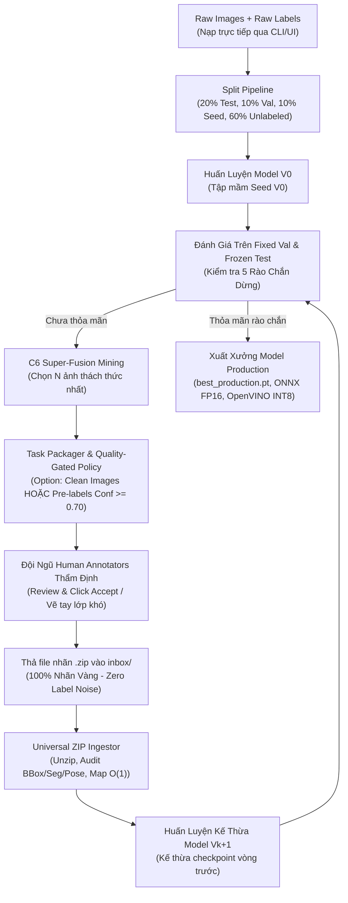

# 🏭 Module 09: Production Human-in-the-Loop (HITL) Active Learning Pipeline

> **Mục tiêu**: Vận hành chu trình Active Learning thực tế trong môi trường sản xuất (Production-Ready) với **100% dữ liệu & nhãn thực tế do người dùng cung cấp (Zero Mock / Zero Simulation)**.
> Hệ thống hỗ trợ đa tác vụ Computer Vision (**Object Detection, Instance Segmentation, Pose Estimation**), cho phép nạp trực tiếp tham số & nhãn thô qua CLI/Notebook mà không cần chỉnh sửa file YAML thủ công.

---

## 🌟 1. Điểm Nổi Bật & Tính Năng Cốt Lõi

1. **Không Giả Lập (100% Real Production Execution)**:
   - Không sử dụng Oracle ảo hay nhãn mock. Toàn bộ chu trình phụ thuộc vào nhãn thực tế do đội ngũ gán nhãn cung cấp qua các file `.zip`.
2. **Nạp Trực Tiếp Tham Số (Direct Parameter Ingestion)**:
   - Tên model (`yolo11n.pt`, `yolo11n-seg.pt`, `yolo11n-pose.pt`, `rtdetr-l.pt`), tác vụ (`detect`, `segment`, `pose`), đường dẫn ảnh thô và kho nhãn ban đầu được nạp trực tiếp qua CLI Flags hoặc Cell 1 của Notebook.
3. **Cơ Chế Nạp Kho Nhãn Thô Ban Đầu (Initial Raw Labels Ingestion)**:
   - Người dùng có thể nạp sẵn kho nhãn ban đầu (dưới dạng thư mục hoặc file `.zip`).
   - Hệ thống tự động map $O(1)$ vào các tập split ban đầu (`fixed_test`, `fixed_val`, `seed_v0`) để bắt đầu huấn luyện ngay Model V0 mà không cần gán nhãn thủ công từ đầu.
4. **Đóng Gói Nhiệm Vụ Kèm Tùy Chọn Pre-label (Task Packager)**:
   - Tự động xuất gói ZIP ảnh cần gán nhãn ra `workspace/outbox/`.
   - **Tùy chọn linh hoạt**: Có thể xuất ảnh sạch thuần túy (không nhãn) HOẶC xuất kèm file nhãn gợi ý (Pre-labels) từ Model tiền nhiệm với bộ lọc tin cậy cao (`confidence >= 0.70`).
5. **Bộ Nạp Nhãn ZIP Đa Năng (Universal ZIP Ingestor)**:
   - Tự động phát hiện và giải nén file `.zip` trong `workspace/inbox/`.
   - Hỗ trợ đa cấu trúc nhãn:
     - **YOLO Bounding Box (5 số)**: `class x_center y_center width height`
     - **YOLO Segmentation (Polygon)**: `class x1 y1 x2 y2 ... xn yn`
     - **YOLO Pose (Keypoints)**: `class x_center y_center width height px1 py1 v1 ...`
     - **COCO JSON**: Tự động chuyển đổi sang chuẩn YOLO tương ứng.
   - Kiểm toán tọa độ nghiêm ngặt trong khoảng $[0, 1]$, loại bỏ box rác/âm.
6. **Kế Thừa Trọng Số & Rào Chắn Dừng Tự Động (Stopping Gates)**:
   - Model vòng $k+1$ tự động kế thừa weights từ checkpoint tốt nhất của vòng $k$.
   - 5 rào chắn dừng: Target mAP50, Plateau bão hòa, Uncertainty cạn kiệt, Budget giới hạn, Số round tối đa.
   - Tự động xuất xưởng mô hình sản xuất: PyTorch (`.pt`), ONNX FP16, OpenVINO INT8.

---

## 📁 2. Cấu Trúc Thư Mục Vận Hành

```
09_production_hitl_pipeline/
├── 09_interactive_production_active_loop.ipynb  # Interactive Notebook cho kỹ sư/nghiên cứu viên
├── run_production_cli.py                        # CLI Production Script chạy tự động/headless
├── config_production.yaml                       # File cấu hình mẫu tham chiếu
├── README.md                                    # Tài liệu hướng dẫn sử dụng
├── src/                                         # Mã nguồn module
│   ├── __init__.py
│   ├── universal_zip_ingestor.py                # Xử lý & audit file ZIP nhãn đa định dạng
│   ├── adaptive_task_packager.py                # Đóng gói task ZIP kèm/không kèm pre-labels
│   ├── stopping_checker.py                      # Bộ kiểm soát 5 tầng rào chắn dừng
│   └── pipeline.py                              # Lớp điều phối trung tâm ProductionHITLPipeline
└── workspace/                                   # Vùng làm việc cô lập
    ├── inbox/                                   # [NẠP] Thả file ZIP nhãn đã gán vào đây
    ├── outbox/                                  # [XUẤT] Tải file ZIP ảnh cần gán nhãn tại đây
    ├── data/
    │   ├── raw_images/                          # Kho ảnh thô ban đầu
    │   ├── raw_labels/                          # Kho nhãn thô ban đầu (nếu có)
    │   └── splits/                              # Các tập split Symlink (test, val, seed, unlabeled)
    └── models/                                  # Lưu checkpoints theo từng vòng & production export
```

---

## 🚀 3. Hướng Dẫn Sử Dụng Chi Tiết

### Cách 1: Sử dụng Interactive Jupyter Notebook (Khuyên Dùng Cho Phân Tích & Giám Sát)

Mở file [`09_interactive_production_active_loop.ipynb`](file:///Users/huynh/orca/workspaces/BuildPhase/tang/notebooks/09_production_hitl_pipeline/09_interactive_production_active_loop.ipynb):

1. **Cell 1**: Khai báo trực tiếp tham số mà không cần sửa file config:
   ```python
   MODEL_NAME = "yolo11n.pt"        # hoặc "yolo11n-seg.pt", "yolo11n-pose.pt"
   TASK = "detect"                  # "detect", "segment", hoặc "pose"
   RAW_IMAGES_DIR = "workspace/data/raw_images"
   RAW_LABELS_PATH = "workspace/data/raw_labels" # Thư mục hoặc file .zip
   INCLUDE_PRELABELS = True         # Bật/tắt nhãn gợi ý
   MIN_CONFIDENCE = 0.70            # Ngưỡng tin cậy
   BUDGET_PER_ROUND = 200           # Số ảnh cần gán mỗi vòng
   ```
2. **Cell 2 & 3**: Khởi tạo pipeline, nạp dữ liệu thô và phân chia 4 tập (`fixed_test`, `fixed_val`, `seed_v0`, `unlabeled_pool`).
3. **Cell 4**: Huấn luyện Baseline Model V0 và đánh giá trên `fixed_val`.
4. **Cell 5 & 6**: Khai thác mẫu không chắc chắn (Uncertainty Mining) và xuất file ZIP nhiệm vụ ra `workspace/outbox/`.
5. **Cell 7**: Chờ người dùng thả file ZIP nhãn vào `workspace/inbox/`. Sau khi thả, cell tiếp theo tự động unzip, nạp nhãn, train Model V1 và lặp lại cho đến khi thỏa mãn rào chắn dừng!

---

### Cách 2: Chạy Tự Động Qua Command Line Interface (CLI Headless)

Phù hợp cho việc cắm vào Server / Worker chạy nền:

```bash
# Lệnh chạy với đầy đủ tham số trực tiếp (không cần chỉnh YAML):
python run_production_cli.py \
    --model yolo11n.pt \
    --task detect \
    --raw-images /path/to/raw_images \
    --raw-labels /path/to/raw_labels.zip \
    --budget 200 \
    --prelabel \
    --min-conf 0.70 \
    --epochs 15 \
    --device mps \
    --watch-inbox
```

#### Bảng Tham Số CLI Chi Tiết:

| Cờ Tham Số | Kiểu Dữ Liệu | Mặc Định | Mô Tả |
| :--- | :--- | :--- | :--- |
| `--model` | `str` | `yolo11n.pt` | Tên model YOLO/RT-DETR (`yolo11n.pt`, `yolo11n-seg.pt`, `yolo11n-pose.pt`...) |
| `--task` | `str` | `detect` | Tác vụ thị giác: `detect`, `segment`, `pose` |
| `--raw-images` | `str` | *None* | Đường dẫn thư mục ảnh thô ban đầu |
| `--raw-labels` | `str` | *None* | Đường dẫn thư mục hoặc file `.zip` chứa nhãn ban đầu |
| `--prelabel` | `flag` | `True` | Bật xuất nhãn gợi ý có độ tin cậy cao vào gói nhiệm vụ ZIP |
| `--min-conf` | `float` | `0.70` | Ngưỡng tin cậy tối thiểu để giữ lại nhãn gợi ý |
| `--budget` | `int` | `200` | Số lượng ảnh cần khai thác để gán nhãn trong mỗi vòng |
| `--epochs` | `int` | `15` | Số epoch huấn luyện trong mỗi vòng |
| `--device` | `str` | `mps` | Thiết bị tính toán: `mps`, `cuda`, `cpu` |
| `--watch-inbox` | `flag` | `True` | Chế độ lắng nghe liên tục thư mục `workspace/inbox/` để tự động kích hoạt |

---

## 🔄 4. Quy Trình Vận Hành Vòng Lặp HITL (Step-by-Step)



---

## 🛡️ 5. Chuẩn Định Dạng File ZIP Nhãn Hỗ Trợ

Người dùng có thể nén file nhãn theo bất kỳ định dạng nào sau đây và thả vào `workspace/inbox/`:

### Cấu trúc thư mục trong ZIP:
```
my_labels.zip
├── 0001.txt
├── 0002.txt
└── ...
```
hoặc có thư mục con:
```
my_labels.zip
└── labels/
    ├── 0001.txt
    └── 0002.txt
```
hoặc định dạng COCO:
```
my_labels.zip
└── annotations.json
```

### Nội dung file `.txt`:
- **Detection**: `class x_center y_center width height` (tất cả chuẩn hóa $[0, 1]$)
- **Segmentation**: `class x1 y1 x2 y2 x3 y3 ... xn yn` (tọa độ đỉnh polygon $[0, 1]$)
- **Pose**: `class x_center y_center width height px1 py1 v1 px2 py2 v2 ...`

Bộ Ingestor sẽ tự động kiểm tra tính hợp lệ của từng dòng nhãn và loại bỏ các đối tượng bị lỗi tọa độ hoặc tràn viền.
